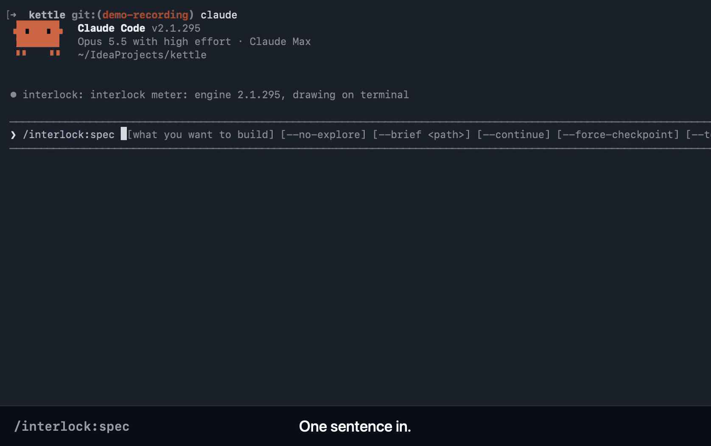
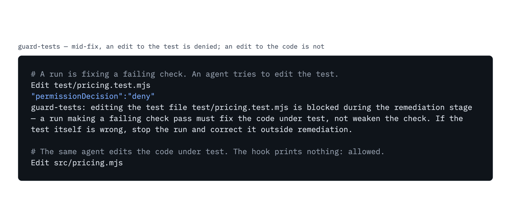
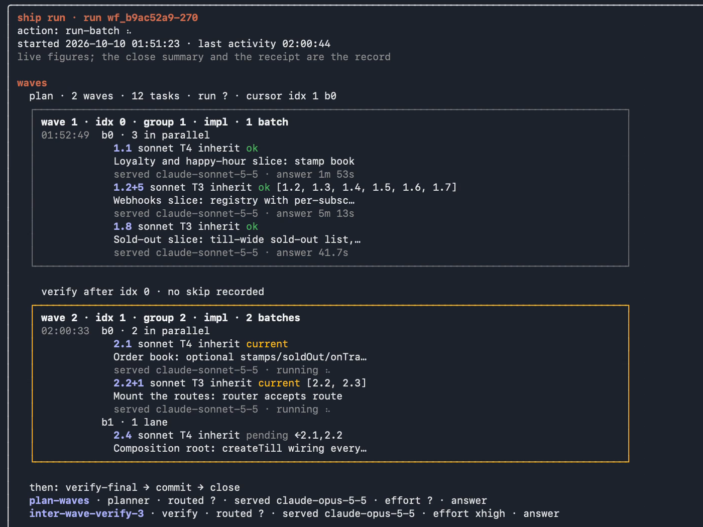
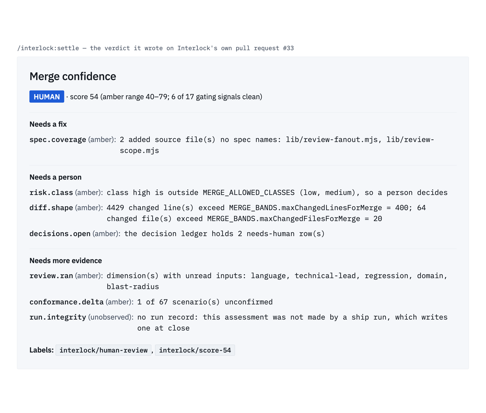

# Interlock

**Read one spec. Parallel agents ship it to a tested commit. One more command settles the pull request.**

Spec-driven development for [Claude Code](https://claude.com/claude-code), on [OpenSpec](https://github.com/Fission-AI/OpenSpec).

[](https://www.npmjs.com/package/@renzrollon/interlock)
[](https://www.npmjs.com/package/@renzrollon/interlock)
[](https://github.com/renzrollon/interlock/actions/workflows/ci.yml)
[](docs/01-first-hour.md#before-you-start)
[](./LICENSE)
[](https://renzrollon.github.io/interlock/)

<p align="center">
  
</p>
<p align="center"><sub>One real run, cut to 34 s: <code>spec</code> stops at the checkpoint, then <code>ship</code> runs two waves of parallel agents to one commit. <a href="https://github.com/renzrollon/interlock/releases/download/v1.5.0/interlock-spec-and-ship-full.mp4">Uncut, 2:34</a>.</sub></p>
<p align="center"><code>12 tasks · 2 waves · 19 agents · 13m 54s · 57 files · 2,881 lines · 180 of 180 pass · 1 commit</code></p>

```text
/interlock:spec "<idea>"   # explores your repo, writes a reviewed spec, then stops
                           # ← you read it. The only required stop.
/interlock:ship            # parallel agents → your tests pass → one commit. Asks nothing.

/interlock:settle          # draft PR → review → fix → re-review → verdict
                           # ← you press merge. Interlock never does.
```

- **One human checkpoint.** A spec is the cheapest place to catch a wrong idea, so it is the one place you must look.
- **Nobody is asked mid-run.** `ship` is a Claude Code workflow, and the runtime has no channel for a question.
- **Rules are code, not prose.** Caps, gates and the merge verdict are CLI exit codes a model cannot argue with.

## Install

In Claude Code, once per machine:

```text
/plugin marketplace add renzrollon/interlock
/plugin install interlock@interlock
```

Then, in a new session in your project, once per repo:

```text
/interlock:bootstrap
```

It writes one spec per existing feature and builds the graph agents navigate by. It never changes source code.

**Nothing else to install.** OpenSpec is provisioned on first use: a pinned copy from npm, checked against a lockfile the plugin carries, install scripts and telemetry off.

**You need** Claude Code **2.1.154+** with [dynamic workflows](https://code.claude.com/docs/en/workflows) on, Node.js **22.12+** with npm, and a git repository with code in it. Every session opens with `interlock preflight OK` or a list of fixes. Step by step: **[01 — The first hour](docs/01-first-hour.md)**.

## Why Interlock

**Prompts are suggestions. Exit codes are not.**

Other spec tools compete on how much structure you write before coding. Interlock competes on **how many decisions the model is not allowed to make.**

- **It cannot ask you anything.** `ship` is a workflow with no input channel. What a human decides is decided at the checkpoint. [06](docs/06-why-it-works.md#2-where-the-plan-lives-and-why-that-decides-everything)
- **It cannot shrink the suite to go green.** A hook denies test edits while a run is fixing a failure, and a settle round with a red suite pushes nothing (1.14). [13](docs/13-the-guards.md)
- **Agents cannot overwrite each other.** The planner separates tasks that touch the same file; with `--isolate-waves` each runs in its own worktree. [06](docs/06-why-it-works.md#5-the-wave-engine)
- **A reviewer has to prove what it read.** Each review dimension hands in a coverage ledger. No proof, no `MERGE` (1.12). [15](docs/15-merge-confidence.md#the-proof-of-coverage)
- **A dismissal needs a `file:line`.** Reviewers run blind, one per dimension; skeptics must cite the diff to dismiss a blocker or warning (1.15). [06](docs/06-why-it-works.md#7-review-making-dismissal-expensive)
- **The merge verdict is computed, not opined.** `MERGE`, `HUMAN` or `BLOCK` comes from the CLI. The worst signal wins, and missing evidence counts against you. [15](docs/15-merge-confidence.md)
- **Nothing is silent, nothing phones home.** `interlock limits` prints every cap, every degradation is a named banner, and Interlock makes no network request of its own (1.15). [04](docs/04-when-it-stops.md)

<p align="center">
  <picture>
    <source media="(prefers-color-scheme: dark)" srcset="docs/assets/guard-deny-dark.png">
    
  </picture>
</p>
<p align="center"><sub>The hook's own words, from running it against a throwaway directory. <a href="docs/13-the-guards.md">The guards →</a></sub></p>

**Built with itself.** Every feature here started as a spec and shipped through the same checkpoint: [more than 80 changes](openspec/changes/archive), one folder each.

## How it compares

Already using something?

- **Plan mode** plans for one session, then the same agent builds. Interlock keeps the spec in your repo, builds with fresh parallel agents and keeps gating after you approve.
- **[OpenSpec](https://github.com/Fission-AI/OpenSpec)**: keep it. Interlock drives the same CLI and files, and adds the run: exploration, a spec review, parallel waves, verification, a commit and a pull request. [03](docs/03-openspec-vs-interlock.md)
- **[Spec Kit](https://github.com/github/spec-kit)** runs five commands per feature, "reviewing each result before continuing". Interlock asks for one read. Spec Kit supports far more agents; that is the trade.
- **[Superpowers](https://github.com/obra/superpowers)** teaches the agent a discipline through skills it reads. Interlock takes the parts with a right answer out of the prompt: a hook denies the edit, an exit code enforces the cap.

| | You do | Builds it | Holds the rules | Ends at |
|---|---|---|---|---|
| Plan mode | approve a plan | the same session | your permission mode | edits in your working tree |
| OpenSpec | propose, apply, archive | one assistant, task by task | skills, and a CLI that validates the artifacts | ticked tasks, archived specs |
| Spec Kit | five commands, a review after each | your agent, in its chat | templates and a constitution | `Converged` |
| Superpowers | sign off a design, then say go | a fresh subagent per task | skills the agent reads | your pick of merge, PR, keep or discard |
| **Interlock** | **read one spec** | **parallel agents in waves** | **exit codes, hooks, a runtime that cannot ask** | **a tested commit, then a verdict on the PR** |

<sub>From each project's own README, November 2026. Nobody has benchmarked these against each other, us included. Sources and the longer version: [08](docs/08-harness-landscape.md#beside-plan-mode-and-the-spec-tools).</sub>

## The flow

<p align="center">
  <a href="https://renzrollon.github.io/interlock/">
    <picture>
      <source media="(max-width: 600px) and (prefers-color-scheme: dark)" srcset="docs/assets/flow-narrow-dark.svg">
      <source media="(max-width: 600px)" srcset="docs/assets/flow-narrow-light.svg">
      <source media="(prefers-color-scheme: dark)" srcset="docs/assets/flow-dark.svg">
      
    </picture>
  </a>
</p>

Two commands per change, and you read the spec between them. Settle and archive carry it from the commit to the merge.

| When | Command | What you get |
|---|---|---|
| once per repo | [`/interlock:bootstrap`](docs/01-first-hour.md#step-1--onboard-the-repo-once "Once per repo. Reads the code, writes one spec per existing feature, builds the graph. Never edits source.") | Your repo, described in specs |
| **every change** | <kbd>/interlock:spec "idea"</kbd> | [A reviewed, implementation-ready change](docs/01-first-hour.md#step-2--spec-one-small-change "Explores the repo, writes proposal, design, tasks and delta specs, reviews them, then stops. Nothing but specs."). Then it stops |
| **every change** | **You read the spec** | [Ten minutes, with a checklist](docs/02-the-checkpoint.md "Four files, one question each. The only required stop. Wrong idea? Re-spec."). The only place a human is required |
| **every change** | <kbd>/interlock:ship</kbd> | [Parallel agents, your tests, one commit](docs/01-first-hour.md#step-4--ship-it "Parallel agents in waves, your suite, one commit. A workflow has no channel for a question, so it never asks one."). Asks nothing |
| after the commit | [`/interlock:settle`](docs/15-merge-confidence.md "Opens or updates the pull request with the MERGE / HUMAN / BLOCK verdict in the description and labels. Never merges.") | The pull request, with the merge verdict on it |
| after the merge | [`openspec archive <change>`](docs/01-first-hour.md#step-6--archive-the-change-once-it-merges "After the merge: fold the delta specs into the living specs, so the next spec plans against what is now true.") | The living specs catch up |

<p align="center">
  
</p>
<p align="center"><sub>The same run, drawn live inside Claude Code (2.1.295+). The pane observes; the CLI decides. <a href="docs/07-cli-and-configuration.md#the-ship-meter-interlock-meter">The ship meter →</a></sub></p>

<details>
<summary><b>Flags, and the commands you may never need</b></summary>

**Shape and gates on `ship`.** `--review` runs the adversarial review before the commit. `--strict` adds remediation, handoff artifacts and a conformance check. `--solo` and `--waves` force the plan shape the classifier would otherwise choose. `--tdd` runs the change's failing-test section first. `spec --continue` skips the checkpoint when the readiness gate passes; [05](docs/05-continuity.md) says what that cannot catch.

**Any time, on their own.** `/interlock:explore` (reconnaissance with parallel investigators), `/interlock:review-code` (the adversarial review, standalone), `/interlock:fix-tests` (repair a red suite by root cause, without weakening a test), `/interlock:graph` (build and query the code graph), `/interlock:report` (indicators over the run corpora, gating nothing), `/interlock:manual-test-plan`, `/interlock:explain-code`, `/interlock:evals`, `/interlock:docs-digest`, `/interlock:dispatch`, `/interlock:commit`.

**Watching.** `/interlock-meter` is the ship run as a pane; `/interlock-spec` the spec run; `/interlock-settle` every `/interlock:settle` pass on a pull request, with or without `--review`; `/interlock-preflight` the session's doctor report; `/interlock-handoff` the resume card after a halt. The checkpoint card (`interlock checkpoint <change>`, also drawn in `/interlock-spec`) lists the questions to ask of a spec, and the panes offer each command they print as a drafted action you submit yourself.

**In the terminal.** `interlock doctor`, `interlock limits`, `interlock drift`, `interlock merge-confidence`. Every subcommand: [07](docs/07-cli-and-configuration.md).
</details>

<details>
<summary><b>Words you will see</b></summary>

| | |
|---|---|
| **Change** | One unit of work: a folder under `openspec/changes/<name>/` holding `proposal.md`, `design.md`, `tasks.md` and delta specs |
| **Delta spec** | The behaviour a change adds or alters, written as Given/When/Then scenarios |
| **Living spec** | `openspec/specs/`: what the system does today. Archiving a change folds its delta specs in |
| **Checkpoint** | Your read of the spec, between `spec` and `ship`. The one step a human must do |
| **Skill** / **workflow** | A skill is instructions Claude follows in the conversation, and it can ask you questions. A workflow is a script the Claude Code runtime executes, and it cannot |
| **Wave** / **lane** | A wave is a batch of tasks that run in parallel; a lane is one agent's slot in it |
| **Halt** | `ship` stopped, said what finished and what it needs from you. [04](docs/04-when-it-stops.md) decodes each one |

Every term, defined from the ground up: [09 — From prompt to workflow](docs/09-from-prompt-to-workflow.md).
</details>

## Then settle the pull request

```text
/interlock:settle --create --review
```

1. **Opens a draft pull request**, described from the spec and the diff.
2. **Reviews the diff** and posts the findings.
3. **Fixes them in rounds.** Each round runs your suite before it commits, so a red round pushes nothing.
4. **Answers every finding**: `fixed`, `open` or `new`.
5. **Labels it `MERGE`, `HUMAN` or `BLOCK`**, with the evidence in the description.

Its verdict on one of Interlock's own pull requests. It did not flatter us:

<p align="center">
  <picture>
    <source media="(prefers-color-scheme: dark)" srcset="docs/assets/settle-verdict-dark.png">
    
  </picture>
</p>

<sub>Every line verbatim from the description of [#33](https://github.com/renzrollon/interlock/pull/33); the signal table and the commit line under it are left out.</sub>

It never merges and never approves: a person presses the button. It needs `gh` or `glab` signed in. The GitHub loop has run end to end; the GitLab lines are not exercised. [15 — Merge confidence](docs/15-merge-confidence.md)

## Turn the gates up

Default `ship` trusts your test suite: a green suite, one commit. Add the rest as the loop earns it.

| Add | What it does | Cost |
|---|---|---|
| `ship --review` | Blind reviewers, one per dimension, then skeptics. You see what survived, and how many did not | The expensive part of a run. [06](docs/06-why-it-works.md) |
| `ship --strict` | The review, plus remediation, a manual test plan for UI changes, a commit walkthrough and a conformance check against the spec | The previous default. [01](docs/01-first-hour.md#step-4--ship-it) |
| `interlock merge-confidence --require-merge` | The settle verdict as a required CI check. Exits 1 unless `MERGE` | Some setup. [15](docs/15-merge-confidence.md#a-ci-job-that-reassesses) |
| `REVIEW.md` | Your repo's policy: paths out of review scope, paths that always need a human | One file. [12](docs/12-repository-review-policy.md) |

## What it costs

- **Claude Code only.** It is the **default and supported host**, because the guarantees come from its workflow runtime. Cursor and Copilot are not supported; a runner for other hosts is experimental.
- **Review spends tokens.** `--review`, `--strict` and `settle --review` are the expensive part of a run, so default `ship` leaves them out.
- **Guards fail open.** A hook that cannot tell a run is live allows the edit, [by design](docs/13-the-guards.md#the-fail-open-rule).

<details>
<summary><b>Fine print: your own OpenSpec, the doctor, other hosts, the network, and the CLIs on their own</b></summary>

**Your own OpenSpec.** A copy already on your PATH is used as it is. Otherwise the first `/interlock:spec` or `/interlock:bootstrap` runs `interlock openspec provision`: about 16 MB from the npm registry, into the plugin's data directory and nowhere else. `interlock openspec which` prints which copy resolves. To install it yourself instead: `npm install --location=global @fission-ai/openspec@2.0.0`. [01](docs/01-first-hour.md#install)

**`interlock doctor`.** The session-start check is `interlock doctor`, run for you. Type `! interlock doctor` at the Claude Code prompt for the full report, with a ready-to-paste snippet that allowlists every command a run needs; it exits 1 when something would stop a zero-touch run. The plugin puts the CLI on the `PATH` of Claude Code's shell only. For your own terminal, install the npm package ([07](docs/07-cli-and-configuration.md#install-the-clis-without-the-plugin)) and keep it at the plugin's version ([16](docs/16-upgrading.md)).

**Other hosts (experimental).** `interlock-run` drives the same loop over the Claude Code CLI, any [Agent Client Protocol (ACP)](https://agentclientprotocol.com) agent, OpenAI Codex or Qwen Code. You start it yourself; no slash command does, and `/interlock:ship` never falls back to it. Two caveats, both bannered by the runner. `claude -p`, the Agent SDK and ACP are the usage Anthropic flagged for separate metered credit, while the Workflow runtime behind `/interlock:ship` is the exempted path. And Codex and Qwen need the planner's model tiers mapped with `INTERLOCK_MODEL_MAP`; an unmapped tier is bannered, never silently run on your default. The older `interlock-ship-acp` still works, prints a deprecation line, and is removed in the next minor. Code Mode is out of scope. Host table, banners and configuration: [07](docs/07-cli-and-configuration.md#interlock-run--the-experimental-runner).

**The network.** Interlock makes no network request of its own and reads no credential; the plugin declares no option to ask you for one.

- **Requests that belong to other tools.** `/interlock:settle` has the model run `gh`, `glab` and `git fetch` under your own sign-in; `interlock openspec provision` runs `npm` to install the pinned OpenSpec from the npm registry when none is on your PATH; the vendor CLIs a run spawns inherit the environment as any child process does. What each of those sends is its own.
- **What it reads and runs on your machine.** `interlock doctor`, the session-start check and `interlock run start` read Claude Code's settings files: managed, user (`~/.claude/settings.json`), project and local. They use only `permissions`, `promptCacheTtl`, `subagentPromptCacheTtl` and `advisorModel`, so they can say whether a run would stop on a prompt. No other key or value is used, printed or sent. `interlock verify exec` runs the command it is passed, which the loop takes from the commands in `.claude/testing/profile.json`, and the coverage baseline runs that profile's coverage command. Both run through a shell (`/bin/sh` on macOS and Linux) and in your environment, as you would run them yourself. Whatever those commands send is theirs, not Interlock's.
- **Being reached while away.** Interlock makes no network call and sends no push of its own; on a Claude Code that supports mods, the meter asks the engine for a local notification on a halt, a close, a first quiet stretch and a checkpoint. Claude Code's [Remote Control](https://code.claude.com/docs/en/remote-control) can push to your phone when a long task finishes or a session needs you, with nothing configured in Interlock.

**The CLIs on their own.** `interlock` (the policy engine), `interlock-graph` (a local, deterministic code graph; no vector store, no network) and `interlock-run` (the runner above) are three zero-dependency Node binaries. The plugin puts them on Claude Code's `PATH`; `npm install --location=global @renzrollon/interlock@1.16.1` puts them on yours. Every gating subcommand exits 1 when it blocks. Reference and every environment variable: [07](docs/07-cli-and-configuration.md).
</details>

## Docs

Start with **[01 — The first hour](docs/01-first-hour.md)**, and keep [04 — When it stops](docs/04-when-it-stops.md) open during your first `ship`. Then [02](docs/02-the-checkpoint.md) for reading a spec in ten minutes and [06](docs/06-why-it-works.md) for the mechanisms. Only ever prompted a coding agent? [09](docs/09-from-prompt-to-workflow.md) defines every term once.

<details>
<summary><b>Every doc</b></summary>

| | |
|---|---|
| [01 — The first hour](docs/01-first-hour.md) | Install to first shipped change |
| [02 — The checkpoint](docs/02-the-checkpoint.md) | How to read a spec in ten minutes |
| [03 — OpenSpec vs Interlock](docs/03-openspec-vs-interlock.md) | What composes with what |
| [04 — When it stops](docs/04-when-it-stops.md) | Every halt and banner, and what to do |
| [05 — Continuity](docs/05-continuity.md) | When `--continue` may skip the human read |
| [06 — Why it works](docs/06-why-it-works.md) | The mechanisms, low-level, with the costs stated |
| [07 — CLI and configuration](docs/07-cli-and-configuration.md) | Every subcommand, environment variable and host |
| [08 — The Interlock harness](docs/08-harness-landscape.md) | The parts of the harness, what holds on each host, and the comparison with other tools |
| [09 — From prompt to workflow](docs/09-from-prompt-to-workflow.md) | New to agentic workflows? Every term defined, then why `ship` is a script |
| [10 — Ship and spec for prompt-only engineers](docs/10-agentic-workflow-ship-and-spec.md) | Primer, review of spec+ship, token and quality tactics |
| [11 — The indicators](docs/11-the-indicators.md) | What `interlock report` measures and why it gates nothing; whether to commit the run corpora |
| [12 — Repository review policy](docs/12-repository-review-policy.md) | The optional `REVIEW.md`: what it can change and what it cannot |
| [13 — The guards](docs/13-the-guards.md) | The hooks, the stage marker's lifecycle, and the fail-open rule |
| [14 — Evals](docs/14-evals.md) | What a consumer's run is checked by, why no model evals run in your CI, how to file a failure |
| [15 — Merge confidence](docs/15-merge-confidence.md) | What the `MERGE` / `HUMAN` / `BLOCK` verdict reads, signal by signal, and how it reaches a pull request or a CI job |
| [16 — Upgrading](docs/16-upgrading.md) | What an upgrade keeps, what a resume across versions does, and how to keep the CLI at the plugin's version |
</details>

## Development

```bash
git clone https://github.com/renzrollon/interlock && cd interlock
npm test                      # no dependencies to install first
claude --plugin-dir .         # load it without installing
```

More in [CONTRIBUTING.md](./CONTRIBUTING.md). Report vulnerabilities privately ([SECURITY.md](./SECURITY.md)); [ACCESSIBILITY.md](./ACCESSIBILITY.md) and the [code of conduct](./CODE_OF_CONDUCT.md) cover the rest. Built on [OpenSpec](https://github.com/Fission-AI/OpenSpec) by Fission AI, and on the wave-execution pattern for parallel task application. [MIT](./LICENSE).
