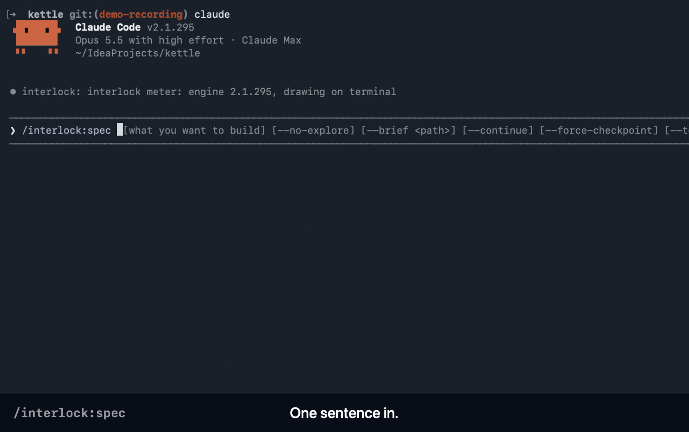
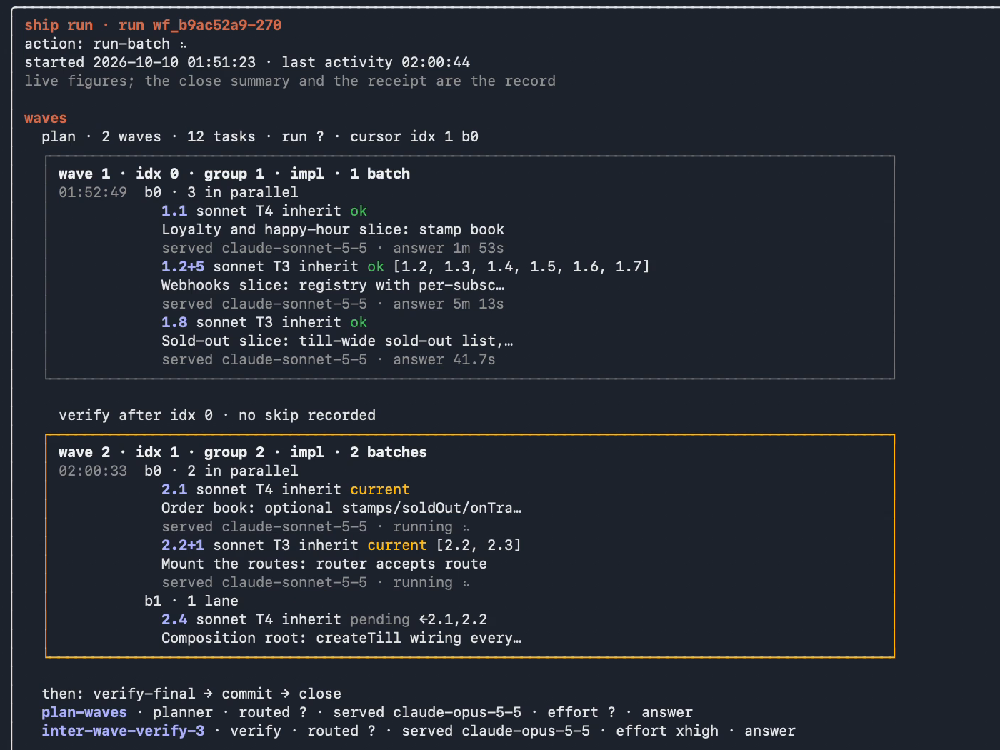

# Interlock

**Spec-driven development for Claude Code. You read one spec; parallel agents ship it to a tested commit.**

[](https://www.npmjs.com/package/@renzrollon/interlock)
[](https://www.npmjs.com/package/@renzrollon/interlock)
[](https://github.com/renzrollon/interlock/actions/workflows/ci.yml)
[](docs/01-first-hour.md#before-you-start)
[](./LICENSE)
[](https://renzrollon.github.io/interlock/)

<p align="center">
  
</p>
<p align="center"><sub>One real run, cut to 34 s. <code>spec</code> asks one question, writes 11 specs and 12 tasks, then stops. <code>ship</code> runs three agents in parallel across two waves and ends in a commit with the suite green, 180 of 180.</sub></p>
<p align="center"><code>12 tasks · 2 waves · 19 agents · 13m 54s · 57 files · 2,881 lines · 180 of 180 pass · 1 commit</code></p>
<p align="center"><sub>The whole run, uncut and captioned: <a href="https://github.com/renzrollon/interlock/releases/download/v1.5.0/interlock-spec-and-ship-full.mp4">2:34, mp4, 9 MB</a>.</sub></p>

```text
/interlock:spec "<idea>"   # explores your repo, writes a reviewed spec, then stops
                           # ← you read it. The only place a human is required.
/interlock:ship            # parallel agents implement → your tests pass → commit. Nobody is asked.
```

- **One human checkpoint.** A spec is the cheapest place to catch a wrong idea, so that is the one place you must look. Everything after it is automatic.
- **Zero-touch by construction.** `ship` is a Claude Code workflow, and the workflow runtime has no channel for mid-run input. It cannot ask you anything, so it never does.
- **Caps and gates are code, not prose.** Parallelism, retry budgets and review thresholds are CLI exit codes a model cannot argue with, and during remediation an agent cannot even edit a test. Re-run any decision yourself, with no model and no network.

## Install

Interlock is a [Claude Code](https://claude.com/claude-code) plugin layered on [OpenSpec](https://github.com/Fission-AI/OpenSpec), which owns the spec format. You need:

| | |
|---|---|
| Claude Code **v2.1.154+** with dynamic workflows enabled | `/interlock:ship` runs as a [workflow](https://code.claude.com/docs/en/workflows). If workflows are turned off, by your settings, an org policy or a Pro plan that has not enabled them in `/config`, the command exists but the run cannot start |
| Node.js **20.19+** | OpenSpec needs 20.19+. Interlock's own CLIs need only 18 |
| A git repository with code in it | Bootstrap describes what already exists |

The full table, including two environment variables that must stay unset, is in [the first hour](docs/01-first-hour.md#before-you-start).

**1. Install the OpenSpec CLI.** In your terminal, once per machine:

```bash
npm install -g @fission-ai/openspec@latest
openspec --version        # prints a version when it worked
```

**2. Install the plugin.** In Claude Code, once per machine:

```text
/plugin marketplace add renzrollon/interlock
/plugin install interlock@interlock
```

**3. Onboard your project.** Start a new session in the project from your terminal (`cd your-project && claude`), then in Claude Code, once per repo:

```text
/interlock:bootstrap
```

Bootstrap runs `openspec init` if the repo has never been initialized. It reads your code, asks you to confirm the list of features it found, then writes one spec per feature describing what the code does today, and builds the graph agents navigate by. It never changes source code.

**4. Read the first line of each session.** Every time a session starts in your project, the plugin checks that an unattended run could finish and prints either `interlock preflight OK` or a list of problems, each with its fix. The most common problem is a command your permission settings do not allow yet. During `ship` nobody is there to approve a prompt, so the run would stop at it. `/permissions` is the quickest way to add what the check names.

> **`interlock doctor` is optional.** The session-start check *is* `interlock doctor`, run for you. Run it yourself only for the full report, which includes a ready-to-paste settings snippet that allowlists every command a run needs:
>
> ```text
> ! interlock doctor
> ```
>
> The `!` runs it from the Claude Code prompt, because the plugin puts the CLI on the `PATH` of Claude Code's shell, not your own terminal's. For your terminal too, install the npm package ([07](docs/07-cli-and-configuration.md#install-the-clis-without-the-plugin)), and keep that copy at the plugin's version: `doctor` says when it is not ([16](docs/16-upgrading.md)). It exits 1 when it finds something that would stop a zero-touch run.

Your first shipped change, step by step: **[01 — The first hour](docs/01-first-hour.md)**.

## The flow

<p align="center">
  <a href="https://renzrollon.github.io/interlock/#flow">
    <picture>
      <source media="(max-width: 600px) and (prefers-color-scheme: dark)" srcset="docs/assets/flow-narrow-dark.svg">
      <source media="(max-width: 600px)" srcset="docs/assets/flow-narrow-light.svg">
      <source media="(prefers-color-scheme: dark)" srcset="docs/assets/flow-dark.svg">
      
    </picture>
  </a>
</p>

You type two commands for every change and read the spec between them. The rest is there when you want it.

| When | Command | What you get |
|---|---|---|
| once per repo | [`/interlock:bootstrap`](docs/01-first-hour.md#step-1--onboard-the-repo-once "Once per repo. Reads the code, writes one spec per existing feature, builds the graph. Never edits source.") | Your repo, described in specs |
| **every change** | <kbd>/interlock:spec "idea"</kbd> | [A reviewed, implementation-ready change](docs/01-first-hour.md#step-2--spec-one-small-change "Explores the repo, writes proposal, design, tasks and delta specs, reviews them, then stops. Nothing but specs."). Then it stops |
| **every change** | **You read the spec** | [Ten minutes, with a checklist](docs/02-the-checkpoint.md "Four files, one question each. The only required stop. Wrong idea? Re-spec."). The only place a human is required |
| **every change** | <kbd>/interlock:ship</kbd> | [Parallel agents, your tests, one commit](docs/01-first-hour.md#step-4--ship-it "Parallel agents in waves, your suite, one commit. A workflow has no channel for a question, so it never asks one."). Asks nothing |
| when you want it | [`/interlock:settle`](docs/15-merge-confidence.md "Opens or updates the pull request with the MERGE / HUMAN / BLOCK verdict in the description and labels. Never merges.") | The pull request, with the merge verdict on it |
| after the merge | [`openspec archive <change>`](docs/01-first-hour.md#step-6--archive-the-change-once-it-merges "After the merge: fold the delta specs into the living specs, so the next spec plans against what is now true.") | The living specs catch up |

After a ship, `/interlock:settle --create --review` pushes the branch, opens the pull request as a draft, reviews it (the lean default set of review dimensions, or the wider set with `--strict`, with the blast-radius dimension when the repository has a graph; it is skipped, and says so, without one), posts the findings as a comment, remediates what it can, posts a reply comment saying which findings are `fixed`, `open` or `new`, and marks it ready with the merge verdict and the head-bound evidence in its description. It never merges and never approves; a person still presses the button. The GitHub loop is not exercised end to end until a first run on a real pull request is recorded. [Details](docs/15-merge-confidence.md).

<details>
<summary><b>Flags, and the commands you may never need</b></summary>

**Shape and gates on `ship`.** `--review` runs the adversarial review before the commit. `--strict` adds remediation, handoff artifacts and a conformance check. `--solo` and `--waves` force the plan shape the classifier would otherwise choose. `--tdd` runs the change's failing-test section first. `spec --continue` skips the checkpoint when the readiness gate passes; [05](docs/05-continuity.md) says what that cannot catch.

**Any time, on their own.** `/interlock:explore` (reconnaissance with parallel investigators), `/interlock:review-code` (the adversarial review, standalone), `/interlock:fix-tests` (repair a red suite by root cause, without weakening a test), `/interlock:graph` (build and query the code graph), `/interlock:report` (indicators over the run corpora, gating nothing), `/interlock:manual-test-plan`, `/interlock:explain-code`, `/interlock:evals`, `/interlock:docs-digest`, `/interlock:dispatch`, `/interlock:commit`.

**Watching.** `/interlock-meter` is the ship run as a pane; `/interlock-spec` the spec run; `/interlock-preflight` the session's doctor report; `/interlock-handoff` the resume card after a halt.

**In the terminal.** `interlock doctor`, `interlock limits`, `interlock drift`, `interlock merge-confidence`. Every subcommand: [07](docs/07-cli-and-configuration.md).
</details>

<details>
<summary><b>Words you will see</b></summary>

| | |
|---|---|
| **Change** | One unit of work: a folder under `openspec/changes/<name>/` holding `proposal.md`, `design.md`, `tasks.md` and delta specs |
| **Delta spec** | The behaviour a change adds or alters, written as Given/When/Then scenarios |
| **Living spec** | `openspec/specs/`: what the system does today. Archiving a change folds its delta specs in |
| **Checkpoint** | Your read of the spec, between `spec` and `ship`. The one step a human must do |
| **Skill** / **workflow** | A skill is instructions Claude follows in the conversation, and it can ask you questions. A workflow is a script the Claude Code runtime executes, and it cannot |
| **Wave** / **lane** | A wave is a batch of tasks that run in parallel; a lane is one agent's slot in it |
| **Halt** | `ship` stopped, said what finished and what it needs from you. [04](docs/04-when-it-stops.md) decodes each one |

Every term, defined from the ground up: [09 — From prompt to workflow](docs/09-from-prompt-to-workflow.md).
</details>

<p align="center">
  
</p>
<p align="center"><sub>The same run, drawn inside Claude Code while it ran: every wave, batch and lane as the CLI reported them.</sub></p>

On Claude Code 2.1.287 and later the plugin draws both runs live: a status line that stops at the checkpoint, a pane of every wave, lane and agent, and each degradation banner as a toast the moment it is raised. The pane observes; the CLI decides. On an older host the run is the same, without the pane. [The ship meter →](docs/07-cli-and-configuration.md#the-ship-meter-interlock-meter)

## Turn the gates up

Default `ship` trusts your test suite: a green suite, one commit, nothing else. None of the rows below is needed for your first change. Add them one at a time as the loop earns it; each costs what its last column says.

| Add | What it does | Cost |
|---|---|---|
| `ship --review` | Up to seven review dimensions in parallel, then two skeptics who must cite a `file:line` in the diff to dismiss anything. You see only what survived, and how many did not | The expensive part of a run. [06](docs/06-why-it-works.md) |
| `ship --strict` | The review, plus remediation, a manual test plan when UI changed, a walkthrough of the commit, and a conformance check of the diff against the spec's scenarios | The previous default. [01](docs/01-first-hour.md#step-4--ship-it) |
| `/interlock:settle` | Opens or updates the PR with a `MERGE`, `HUMAN` or `BLOCK` verdict in its labels and description, and what would lift it. Never merges, never approves | Needs `gh` or `glab` signed in. [15](docs/15-merge-confidence.md) |
| `interlock merge-confidence --require-merge` in CI | The same verdict as a required check. It re-reads the evidence a run left and runs no review of its own. Exits 1 unless `MERGE` | Some setup. [15](docs/15-merge-confidence.md#a-ci-job-that-reassesses) |
| `REVIEW.md` | Your repo's own policy: paths out of review scope, paths that always need a human | One file. [12](docs/12-repository-review-policy.md) |

## Why Interlock

Most of the category competes on how much structure you write before coding: Spec Kit adds phases, BMAD adds roles, Kiro adds an IDE. Interlock competes on **how many decisions the model is not allowed to make.**

- **Parallel agents cannot overwrite each other.** The planner separates tasks that would touch the same file. With `--isolate-waves`, every parallel task runs in its own git worktree and a collision is a named halt, never a lost write.
- **An agent cannot make the suite smaller to make it green.** During remediation a hook denies test edits, task ticks and commits outside the commit stage. They are `PreToolUse` hooks, inert outside a run. [13](docs/13-the-guards.md)
- **A dismissal needs evidence.** A reviewer who says "not real" must cite a `file:line` in the diff, or it dismisses nothing. [06](docs/06-why-it-works.md)
- **Specs do not quietly rot.** `interlock drift` reports unarchived changes, specs citing missing files and code no spec describes, each at its own confidence, and never blocks. [03](docs/03-openspec-vs-interlock.md)
- **Degradation is spoken, never silent.** A missing graph, an overridden model, a failed push: each is a named banner in the summary. [04](docs/04-when-it-stops.md)
- **Built with itself.** Every feature here started as a spec and went through the same checkpoint and ship. [The archive](openspec/changes/archive) is the record, one folder per change.

| | Competes on | Where the rules live |
|---|---|---|
| Spec Kit | phases you write before code | prompt templates, portable across thirty agents |
| BMAD | roles you assign | prompt templates |
| Kiro | an IDE with specs built in | the IDE |
| OpenSpec | the artifact loop and its CLI | the CLI validates artifacts; skills run the loop |
| **Interlock** | how many decisions the model may not make | a CLI with exit codes, and a runtime with no channel for a question |

It composes OpenSpec rather than replacing it: `/interlock:spec` drives the `openspec` CLI, and the stock OpenSpec skills stay available for the plain artifact loop. [03](docs/03-openspec-vs-interlock.md) says when each is the right call; [08](docs/08-harness-landscape.md) sets the harness beside OpenClaw, Hermes Agent and DeepSeek Harness. The trade is portability: Claude Code is the **default and supported host**, and Cursor and Copilot are not supported, because the guarantees come from Claude Code's workflow runtime.

<details>
<summary><b>Fine print: other hosts, the network, and the CLIs on their own</b></summary>

**Other hosts (experimental).** `interlock-run` drives the same loop over the Claude Code CLI, any [Agent Client Protocol (ACP)](https://agentclientprotocol.com) agent, OpenAI Codex or Qwen Code. You start it yourself; no slash command does, and `/interlock:ship` never falls back to it. Two caveats, both bannered by the runner. `claude -p`, the Agent SDK and ACP are the usage Anthropic flagged for separate metered credit, while the Workflow runtime behind `/interlock:ship` is the exempted path. And Codex and Qwen need the planner's model tiers mapped with `INTERLOCK_MODEL_MAP`; an unmapped tier is bannered, never silently run on your default. The older `interlock-ship-acp` still works, prints a deprecation line, and is removed in the next minor. Code Mode is out of scope. Host table, banners and configuration: [07](docs/07-cli-and-configuration.md#interlock-run--the-experimental-runner).

**The network.** Everything runs without a model and without the network, with one opt-in exception: `interlock notify` pushes one message, so a run or a checkpoint reached while nobody was watching can still reach you.

- **What is sent.** `run close --notify` sends the close summary's first line, the change name and the run id. The spec checkpoint sends the change name. An `interlock notify` you type sends the title and body you give it.
- **Where it goes.** To the [ntfy](https://ntfy.sh) server named by the plugin's `ntfy server` option or by `INTERLOCK_NTFY_URL` (the public `https://ntfy.sh` by default), under the topic in the plugin's `ntfy topic` option or `INTERLOCK_NTFY_TOPIC`. With no topic set, no request is ever made.
- **What identifies you.** No account, key or token goes with the request. The topic is the only thing in it that identifies you, so treat it as a secret.
- **How an option reaches the CLI.** A plugin option reaches hooks only, so each option has a session-start hook of its own, which the host runs only when that option is saved, and it writes the matching variable into the session's environment unless you already set it.
- **Requests that belong to other tools.** `/interlock:settle` has the model run `gh`, `glab` and `git fetch` under your own sign-in; those requests are those tools'. `interlock doctor` reports whether `ANTHROPIC_API_KEY` or `CLAUDE_CODE_OAUTH_TOKEN` is set, by name and never by value. The vendor CLIs a run spawns inherit the environment as any child process does; what they send is theirs.

Interlock makes no other request.

**The CLIs on their own.** `interlock` (the policy engine), `interlock-graph` (a local, deterministic code graph; no vector store, no network) and `interlock-run` (the runner above) are three zero-dependency Node binaries. The plugin puts them on Claude Code's `PATH`; `npm install -g @renzrollon/interlock` puts them on yours. Every gating subcommand exits 1 when it blocks. Reference and every environment variable: [07](docs/07-cli-and-configuration.md).
</details>

## Docs

New here? Start with **[01 — The first hour](docs/01-first-hour.md)**, and keep [04 — When it stops](docs/04-when-it-stops.md) open during your first `ship`. Only ever prompted a coding agent? **[09](docs/09-from-prompt-to-workflow.md)** defines every term once, ending at why `ship` is a script and not a prompt.

| | |
|---|---|
| [01 — The first hour](docs/01-first-hour.md) | Install to first shipped change |
| [02 — The checkpoint](docs/02-the-checkpoint.md) | How to read a spec in ten minutes |
| [03 — OpenSpec vs Interlock](docs/03-openspec-vs-interlock.md) | What composes with what |
| [04 — When it stops](docs/04-when-it-stops.md) | Every halt and banner, and what to do |
| [05 — Continuity](docs/05-continuity.md) | When `--continue` may skip the human read |
| [06 — Why it works](docs/06-why-it-works.md) | The mechanisms, low-level, with the costs stated |
| [07 — CLI and configuration](docs/07-cli-and-configuration.md) | Every subcommand, environment variable and host |
| [08 — The Interlock harness](docs/08-harness-landscape.md) | The parts of the harness, what holds on each host, and a short comparison with other harnesses |
| [09 — From prompt to workflow](docs/09-from-prompt-to-workflow.md) | New to agentic workflows? Every term defined, then why `ship` is a script |
| [10 — Ship and spec for prompt-only engineers](docs/10-agentic-workflow-ship-and-spec.md) | Primer, review of spec+ship, token and quality tactics |
| [11 — The indicators](docs/11-the-indicators.md) | What `interlock report` measures and why it gates nothing; whether to commit the run corpora |
| [12 — Repository review policy](docs/12-repository-review-policy.md) | The optional `REVIEW.md`: what it can change and what it cannot |
| [13 — The guards](docs/13-the-guards.md) | The hooks, the stage marker's lifecycle, and the fail-open rule |
| [14 — Evals](docs/14-evals.md) | What a consumer's run is checked by, why no model evals run in your CI, how to file a failure |
| [15 — Merge confidence](docs/15-merge-confidence.md) | What the `MERGE` / `HUMAN` / `BLOCK` verdict reads, signal by signal, and how it reaches a pull request or a CI job |
| [16 — Upgrading](docs/16-upgrading.md) | What an upgrade keeps, what a resume across versions does, and how to keep the CLI at the plugin's version |

## Development

```bash
git clone https://github.com/renzrollon/interlock && cd interlock
npm test                      # no dependencies to install first
claude --plugin-dir .         # load it without installing
```

More in [CONTRIBUTING.md](./CONTRIBUTING.md). Report vulnerabilities privately ([SECURITY.md](./SECURITY.md)); [ACCESSIBILITY.md](./ACCESSIBILITY.md) and the [code of conduct](./CODE_OF_CONDUCT.md) cover the rest. Built on [OpenSpec](https://github.com/Fission-AI/OpenSpec) by Fission AI, and on the wave-execution pattern for parallel task application. [MIT](./LICENSE).
