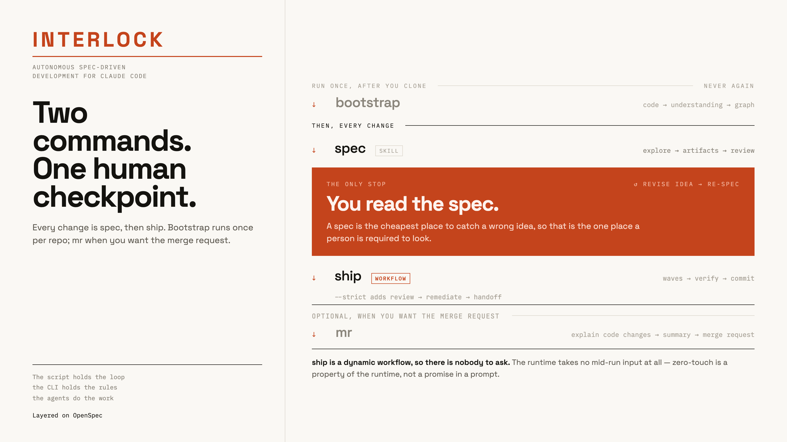

# Interlock

**Spec-driven development for Claude Code. You read one spec; parallel agents ship it to a tested commit.**

[](https://www.npmjs.com/package/@renzrollon/interlock)
[](https://github.com/renzrollon/interlock/actions/workflows/ci.yml)
[](docs/01-first-hour.md#before-you-start)
[](./LICENSE)
[](https://renzrollon.github.io/interlock/)

<p align="center">
  
</p>
<p align="center"><sub>One real run, cut to 34 s. <code>spec</code> asks one question, writes 11 specs and 12 tasks, then stops. <code>ship</code> runs three agents in parallel across two waves and ends in a commit with the suite green, 180 of 180.</sub></p>
<p align="center"><code>12 tasks · 2 waves · 19 agents · 13m 54s · 57 files · 2,881 lines · 180 of 180 pass · 1 commit</code></p>
<p align="center"><sub>The whole run, uncut and captioned: <a href="https://github.com/renzrollon/interlock/releases/download/v1.5.0/interlock-spec-and-ship-full.mp4">2:34, mp4, 9 MB</a>.</sub></p>

```text
/interlock:spec "<idea>"   # explores your repo, writes a reviewed spec, then stops
                           # ← you read it. The only place a human is required.
/interlock:ship            # parallel agents implement → your tests pass → commit. Nobody is asked.
```

- **One human checkpoint.** A spec is the cheapest place to catch a wrong idea, so that is the one place you must look. Everything after it is automatic.
- **Zero-touch by construction.** `ship` is a Claude Code workflow, and the workflow runtime has no channel for mid-run input. It cannot ask you anything, so it never does.
- **Caps and gates are code, not prose.** Parallelism, retry budgets and review thresholds are CLI exit codes a model cannot argue with, and during remediation an agent cannot even edit a test. Re-run any decision yourself, with no model and no network.

## Install

Interlock is a [Claude Code](https://claude.com/claude-code) plugin layered on [OpenSpec](https://github.com/Fission-AI/OpenSpec), which owns the spec format. You need:

| | |
|---|---|
| Claude Code **v2.1.154+** with dynamic workflows enabled | `/interlock:ship` runs as a [workflow](https://code.claude.com/docs/en/workflows). If workflows are turned off, by your settings, an org policy or a Pro plan that has not enabled them in `/config`, the command exists but the run cannot start |
| Node.js **20.19+** | OpenSpec needs 20.19+. Interlock's own CLIs need only 18 |
| A git repository with code in it | Bootstrap describes what already exists |

The full table, including two environment variables that must stay unset, is in [the first hour](docs/01-first-hour.md#before-you-start).

**1. Install the OpenSpec CLI.** In your terminal, once per machine:

```bash
npm install -g @fission-ai/openspec@latest
openspec --version        # prints a version when it worked
```

**2. Install the plugin.** In Claude Code, once per machine:

```text
/plugin marketplace add renzrollon/interlock
/plugin install interlock@interlock
```

**3. Onboard your project.** Start a new session in the project from your terminal (`cd your-project && claude`), then in Claude Code, once per repo:

```text
/interlock:bootstrap
```

Bootstrap runs `openspec init` if the repo has never been initialized. It reads your code, asks you to confirm the list of features it found, then writes one spec per feature describing what the code does today, and builds the graph agents navigate by. It never changes source code.

**4. Read the first line of each session.** Every time a session starts in your project, the plugin checks that an unattended run could finish and prints either `interlock preflight OK` or a list of problems, each with its fix. The most common problem is a command your permission settings do not allow yet. During `ship` nobody is there to approve a prompt, so the run would stop at it. `/permissions` is the quickest way to add what the check names.

> **`interlock doctor` is optional.** The session-start check *is* `interlock doctor`, run for you. Run it yourself only for the full report, which includes a ready-to-paste settings snippet that allowlists every command a run needs:
>
> ```text
> ! interlock doctor
> ```
>
> The `!` runs it from the Claude Code prompt, because the plugin puts the CLI on the `PATH` of Claude Code's shell, not your own terminal's. For your terminal too, install the npm package ([07](docs/07-cli-and-configuration.md#install-the-clis-without-the-plugin)). It exits 1 when it finds something that would stop a zero-touch run.

Your first shipped change, step by step: **[01 — The first hour](docs/01-first-hour.md)**.

## The flow

| Step | What happens | Where |
|---|---|---|
| `/interlock:bootstrap` | Onboard a repo, once | Claude Code (skill) |
| `/interlock:spec "<idea>"` | Idea → explored, reviewed, implementation-ready change. Asks you what the repo cannot answer, then stops having written only specs | Claude Code (skill) |
| **You read the spec** | The checkpoint. [Ten minutes, with a checklist](docs/02-the-checkpoint.md) | you |
| `/interlock:ship` | Reviewed change → waves (parallel batches of tasks that touch different files) → your test suite → one commit. `--solo` / `--waves` force the shape | Claude Code (**workflow**) |
| `/interlock:mr` | *Optional.* Change → merge request, with the merge-confidence verdict. [See below](#optional-review-gates-and-merge-requests) | Claude Code (skill) |
| `openspec archive <change>` | After it merges: fold the change into the living specs, so the next spec plans against what is now true | terminal |

<p align="center">
  
</p>

`ship` is the odd one out on purpose. A skill is instructions Claude follows; a workflow is a script a runtime executes, and this runtime has no channel for a question. That is why every decision that could need a human is settled *before* ship starts, and why `spec` is conversational where it has to be. The plan preview names the shape and the agent count before anything is spawned.

<p align="center">
  
</p>
<p align="center"><sub>The same run, drawn inside Claude Code while it ran: every wave, batch and lane as the CLI reported them.</sub></p>

**You can watch it.** On Claude Code 2.1.287 and later the plugin's hooks module draws the run as it goes: a status line that names the stage and stops at the checkpoint, a pane with every wave, lane and agent, and each degradation banner as a toast the moment the step that raised it prints. The pane observes; the CLI decides. On an older host the run is the same, without the pane. [The ship meter →](docs/07-cli-and-configuration.md#the-ship-meter-interlock-meter)

## Optional: review gates and merge requests

Default `ship` stops at a green suite and a commit. None of the layers below is needed for your first change. Add them once the basic loop works for you.

| Add | What it does | Read |
|---|---|---|
| `/interlock:ship --review` | An adversarial code review before the commit. Up to seven review dimensions run in parallel, then two skeptics attack every finding, and only what survives reaches you | [06 — Why it works](docs/06-why-it-works.md) |
| `/interlock:ship --strict` | The review, plus handoff artifacts (a manual test plan when UI changed, a walkthrough of the commit) and a conformance check of the diff against the spec's scenarios | [01](docs/01-first-hour.md#step-4--ship-it) |
| `/interlock:mr` | Opens or updates the merge request on GitHub or GitLab, using the `gh` or `glab` you are signed in to. The CLI's merge-confidence verdict, `MERGE`, `HUMAN` or `BLOCK`, goes on the labels and in the description, which also says what would lift it. It never merges or approves | [15 — Merge confidence](docs/15-merge-confidence.md) |
| `interlock merge-confidence --require-merge` in CI | The same verdict as a required check: it exits 1 unless the verdict is `MERGE`. It re-reads the evidence a ship run left and runs no review of its own, so it needs some setup first | [15](docs/15-merge-confidence.md#a-ci-job-that-reassesses) |
| `REVIEW.md` | Your repo's own review policy: paths that are out of review scope, and paths that always need a human | [12 — Repository review policy](docs/12-repository-review-policy.md) |

## Words you will see

| | |
|---|---|
| **Change** | One unit of work: a folder under `openspec/changes/<name>/` holding `proposal.md`, `design.md`, `tasks.md` and delta specs |
| **Delta spec** | The behaviour a change adds or alters, written as Given/When/Then scenarios |
| **Living spec** | `openspec/specs/`: what the system does today. Archiving a change folds its delta specs in |
| **Checkpoint** | Your read of the spec, between `spec` and `ship`. The one step a human must do |
| **Skill** | Instructions Claude follows in the conversation. It can ask you questions |
| **Workflow** | A script the Claude Code runtime executes. It cannot ask you anything |
| **Wave** / **lane** | A wave is a batch of tasks that run in parallel; a lane is one agent's slot in it |
| **Halt** | `ship` stopped, said what finished and what it needs from you. [04](docs/04-when-it-stops.md) decodes each one |

Every term, defined from the ground up: [09 — From prompt to workflow](docs/09-from-prompt-to-workflow.md).

## Why this and not a folder of prompts

Decisions that have a correct answer are moved out of prose and into code, one at a time. The script holds the loop, the CLI holds the rules, the agents do the work. Interlock is built with Interlock: the features and fixes here start as OpenSpec changes and go through the same spec, checkpoint and ship, and [openspec/changes/archive](openspec/changes/archive) is the record, one folder per change.

- **Thresholds are code.** Wave order, the parallel-agent cap, the remediation round budget, the review quality band: each is an `interlock` subcommand with an exit code, not markdown a model can talk itself past. [Every subcommand →](docs/07-cli-and-configuration.md)
- **Parallel agents cannot overwrite each other.** The planner separates tasks that would touch the same file; with `--isolate-waves`, every parallel task runs in its own git worktree and a collision is a named halt, never a lost write.
- **Reviews you can actually read.** On `--strict`, up to seven review dimensions run in parallel (the seventh, `domain`, when the change touches a capability that has a living spec), then two skeptics attack every finding. A dismissal must cite a `file:line` in the diff or it dismisses nothing. You see only what survived, and how many did not. [How and why →](docs/06-why-it-works.md)
- **A guard, not a request.** During remediation an agent cannot edit a test, tick a task box, or commit outside the commit stage. They are `PreToolUse` hooks, inert outside a run. [The guards →](docs/13-the-guards.md)
- **Specs that don't quietly rot.** `interlock drift` reports unarchived changes, specs citing missing files, and code no spec describes. Each at its own confidence level, and it never blocks. [OpenSpec vs Interlock →](docs/03-openspec-vs-interlock.md)
- **Degradation is spoken, never silent.** A missing graph, an overridden model, a failed push, a host that cannot report tokens: each is a named banner in the summary. [When it stops →](docs/04-when-it-stops.md)

## How it compares

Most of the category competes on how much structure you write before coding — Spec Kit adds phases, BMAD adds roles, Kiro adds an IDE. Interlock competes on a different axis: **how many decisions the model is not allowed to make.**

| | Competes on | Where the rules live |
|---|---|---|
| Spec Kit | phases you write before code | prompt templates, portable across thirty agents |
| BMAD | roles you assign | prompt templates |
| Kiro | an IDE with specs built in | the IDE |
| OpenSpec | the artifact loop and its CLI | the CLI validates artifacts; skills run the loop |
| **Interlock** | how many decisions the model may not make | a CLI with exit codes, and a runtime with no channel for a question |

It composes OpenSpec rather than replacing it. `openspec init` installs its own skills, and `/interlock:spec` drives the `openspec` CLI directly, so both stay available. Use `/interlock:spec` when you want the gates, and the stock skills when you want the plain artifact loop. What Interlock adds, and when plain OpenSpec is the right call: [03](docs/03-openspec-vs-interlock.md). What the harness is made of, and where it sits beside OpenClaw, Hermes Agent and DeepSeek Harness: [08](docs/08-harness-landscape.md).

The trade is portability. Claude Code is the **default and supported host**; Cursor and Copilot are not supported. Everything the loop decides lives in a CLI any host can shell out to, so portability means a second host adapter, not thirty prompt templates.

## Beyond Claude Code (experimental)

`interlock-run` drives the same loop over the Claude Code CLI, any [Agent Client Protocol (ACP)](https://agentclientprotocol.com) agent, OpenAI Codex or Qwen Code. You start it yourself. No slash command does, and `/interlock:ship` never falls back to it.

Two caveats, both bannered by the runner. `claude -p`, the Agent SDK and ACP are the usage Anthropic flagged for separate metered credit, while the Workflow runtime behind `/interlock:ship` is the exempted path. And Codex and Qwen need the planner's model tiers mapped with `INTERLOCK_MODEL_MAP`; an unmapped tier is bannered, never silently run on your default.

Host table, banners and configuration: [07](docs/07-cli-and-configuration.md#interlock-run--the-experimental-runner). The older `interlock-ship-acp` still works, prints a deprecation line, and is removed in the next minor. Code Mode is out of scope.

## The CLIs

Three zero-dependency Node binaries land on your `PATH`, and they work without the plugin too (`npm install -g @renzrollon/interlock`):

| | |
|---|---|
| `interlock` | The policy engine: `limits`, `gate`, `waves`, `verify`, `doctor`, `report` and the rest. Every gating command exits 1 when it blocks |
| `interlock-graph` | A local, deterministic code knowledge graph. No vector store, no network |
| `interlock-run` | The experimental runner above |

Everything runs without a model and without the network, with one opt-in exception: a push notification for a run that stops while nobody is watching.

- **What is sent.** `run close --notify` sends the close summary's first line, the change name and the run id. The spec checkpoint sends the change name. An `interlock notify` you type sends the title and body you give it.
- **Where it goes.** To the [ntfy](https://ntfy.sh) server named by the plugin's `ntfy server` option or by `INTERLOCK_NTFY_URL` (the public `https://ntfy.sh` by default), under the topic you chose in the plugin's `ntfy topic` option or in `INTERLOCK_NTFY_TOPIC`. With no topic set, no request is ever made.
- **What identifies you.** No account, key or token goes with the request. The topic is the only thing in it that identifies you, so treat it as a secret.
- **How an option reaches the CLI.** The CLI call that pushes is not a hook, and a plugin option reaches hooks only. So each option has a session-start hook of its own, which the host runs only when that option is saved, and it writes the matching variable into the session's environment unless you already set it.
- **Requests that belong to other tools.** `/interlock:mr` has the model run `gh`, `glab` and `git fetch` under your own sign-in to read and write a merge request; those requests are those tools'. `interlock doctor` reports whether `ANTHROPIC_API_KEY` or `CLAUDE_CODE_OAUTH_TOKEN` is set, by name and never by value. The vendor CLIs a run spawns inherit the environment as any child process does; what they send is theirs.

Interlock makes no other request. Reference and every environment variable: [07 — CLI and configuration](docs/07-cli-and-configuration.md).

## Docs

New here? Start with **[01 — The first hour](docs/01-first-hour.md)**, and keep [04 — When it stops](docs/04-when-it-stops.md) open during your first `ship`. Only ever prompted a coding agent? **[09](docs/09-from-prompt-to-workflow.md)** defines every term once, ending at why `ship` is a script and not a prompt.

| | |
|---|---|
| [01 — The first hour](docs/01-first-hour.md) | Install to first shipped change |
| [02 — The checkpoint](docs/02-the-checkpoint.md) | How to read a spec in ten minutes |
| [03 — OpenSpec vs Interlock](docs/03-openspec-vs-interlock.md) | What composes with what |
| [04 — When it stops](docs/04-when-it-stops.md) | Every halt and banner, and what to do |
| [05 — Continuity](docs/05-continuity.md) | When `--continue` may skip the human read |
| [06 — Why it works](docs/06-why-it-works.md) | The mechanisms, low-level, with the costs stated |
| [07 — CLI and configuration](docs/07-cli-and-configuration.md) | Every subcommand, environment variable and host |
| [08 — The Interlock harness](docs/08-harness-landscape.md) | The parts of the harness, what holds on each host, and a short comparison with other harnesses |
| [09 — From prompt to workflow](docs/09-from-prompt-to-workflow.md) | New to agentic workflows? Every term defined, then why `ship` is a script |
| [10 — Ship and spec for prompt-only engineers](docs/10-agentic-workflow-ship-and-spec.md) | Primer, review of spec+ship, token and quality tactics |
| [11 — The indicators](docs/11-the-indicators.md) | What `interlock report` measures and why it gates nothing; whether to commit the run corpora |
| [12 — Repository review policy](docs/12-repository-review-policy.md) | The optional `REVIEW.md`: what it can change and what it cannot |
| [13 — The guards](docs/13-the-guards.md) | The hooks, the stage marker's lifecycle, and the fail-open rule |
| [14 — Evals](docs/14-evals.md) | What a consumer's run is checked by, why no model evals run in your CI, how to file a failure |
| [15 — Merge confidence](docs/15-merge-confidence.md) | What the `MERGE` / `HUMAN` / `BLOCK` verdict reads, signal by signal, and how it reaches a merge request or a CI job |

## Development

```bash
git clone https://github.com/renzrollon/interlock && cd interlock
npm test                      # no dependencies to install first
claude --plugin-dir .         # load it without installing
```

More in [CONTRIBUTING.md](./CONTRIBUTING.md). Built on [OpenSpec](https://github.com/Fission-AI/OpenSpec) by Fission AI, and on the wave-execution pattern for parallel task application. [MIT](./LICENSE).
