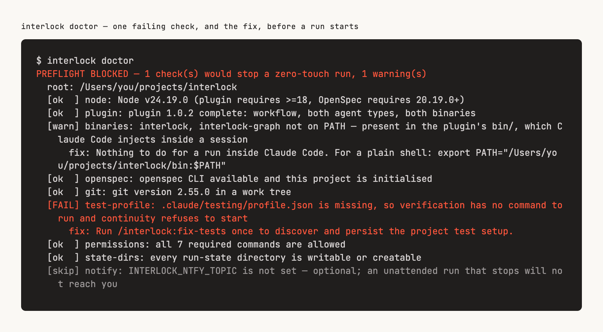
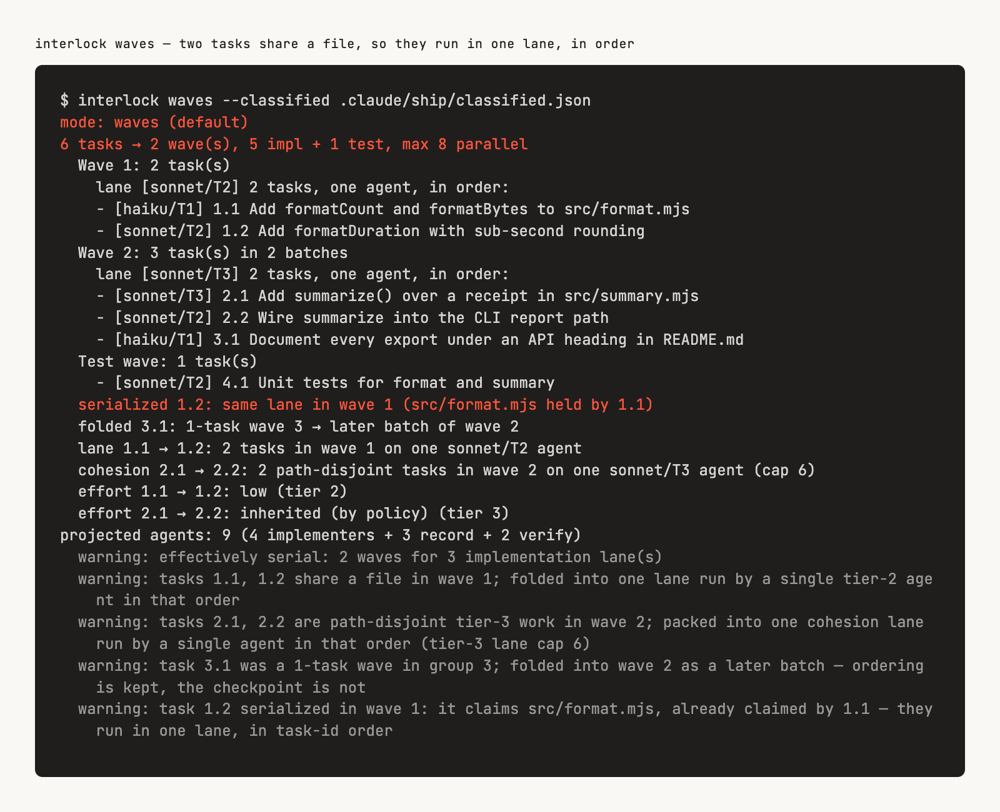

# Your first hour with Interlock

This page takes you from install to one committed change. Onboard the repo once, then spec, read, and ship.

## Before you start

| Requirement | Why |
|---|---|
| [Claude Code](https://claude.com/claude-code) **v2.1.154+** | Interlock is a Claude Code plugin. Cursor and Copilot are not supported. Known-good on 2.1.229. |
| Dynamic workflows **enabled** | `/interlock:ship` is a skill trampoline that launches a [dynamic workflow](https://code.claude.com/docs/en/workflows). Turned off via `disableWorkflows`, org policy, or `CLAUDE_CODE_DISABLE_WORKFLOWS` — and on a Pro plan until you enable it in `/config` — the command exists but the run cannot start. |
| `CLAUDE_CODE_SUBAGENT_MODEL` **unset** | If it is set it overrides every per-tier model the planner assigns, so `ship` runs entirely on that model. The run banners this rather than hiding it — see [when it stops](./04-when-it-stops.md#model-routing-overridden). |
| `CLAUDE_CODE_EFFORT_LEVEL` **unset** | Its effort twin. If it is set every agent runs at that effort, whatever the plan assigned to each step. The run banners it as `EFFORT ROUTING OVERRIDDEN` — see [when it stops](./04-when-it-stops.md#effort-routing-overridden). |
| The [`openspec`](https://github.com/Fission-AI/OpenSpec) CLI | Interlock drives it; it owns the artifact formats. Installed below. |
| Node.js ≥ 18 | Runs the three bundled CLIs: `interlock`, `interlock-graph` and `interlock-run`. |
| A git repo with code in it | `bootstrap` documents what already exists. |

## Install

Interlock drives the `openspec` CLI, so install it and initialize it in the repo first ([OpenSpec quick start](https://github.com/Fission-AI/OpenSpec#quick-start)):

```bash
npm install -g @fission-ai/openspec@latest
cd your-project && openspec init
```

If you skip this step, `/interlock:spec`, `/interlock:bootstrap` and `/interlock:dispatch` stop at their first command with this install line, and `interlock doctor` reports it.

OpenSpec itself requires **Node.js 20.19.0+** (higher than Interlock's own ≥ 18) and also installs via pnpm, yarn, bun or nix. `openspec init` creates `openspec/` and installs its stock skills — Interlock composes with those rather than replacing them ([03](./03-openspec-vs-interlock.md)).

Then the plugin:

```bash
/plugin marketplace add renzrollon/interlock
/plugin install interlock@interlock
```

The CLIs also ship as an npm package for use without the plugin — see [07](./07-cli-and-configuration.md#install-the-clis-without-the-plugin).

## Allowlist the commands first

Worth two minutes before your first `ship`. Workflow agents inherit your own permission settings, so a command that is not allowlisted stops the run on an approval prompt — in the middle of a run that is supposed to need nothing from you, possibly while you are away from the keyboard.

<p align="center">
  
</p>

The plugin already runs this check when each session starts, and prints `interlock preflight OK` or each problem with its fix. For the full report, run `interlock doctor` from the Claude Code prompt as `! interlock doctor`. The plugin puts the CLI on the `PATH` of Claude Code's shell, not your own terminal's. It prints the exact commands your run needs allowlisted (derived from what the flow shells out to, plus your own test profile) and the settings snippet that covers them, so this page does not have to enumerate them. `/permissions` is the quickest route to add what it names.

## Step 1 — Onboard the repo (once)

```bash
/interlock:bootstrap
```

This reads your codebase and writes down what it already is. It initializes OpenSpec if the repo has never been initialized, explores in parallel, then writes:

- `openspec/initial-architecture.md` — stack, layout, data model, patterns, inferred design decisions
- `openspec/specs/<feature>/spec.md` — one spec per discovered feature, describing behavior that exists today

It will ask you to confirm the feature list before generating specs, and it never overwrites an existing spec file. On a small repo, `--quick` runs it sequentially in one context:

```bash
/interlock:bootstrap --quick
/interlock:bootstrap --scope packages/api    # restrict to a subdirectory
```

Bootstrap never modifies source code. When it finishes it may suggest `/interlock:docs-digest` — skip that for now.

## Step 2 — Spec one small change

Pick something genuinely small for the first loop: one endpoint, one flag, one bug with a known repro.

```bash
/interlock:spec add a --json flag to the report command
```

It explores first (unless you pass `--no-explore`), then drives the `openspec` CLI to produce the artifacts, then runs an artifact review over them. It writes:

```
openspec/changes/<change-name>/
├── proposal.md      what and why
├── design.md        how, and the decisions taken
├── tasks.md         ordered checkbox tasks
└── specs/**         delta specs — the behavior change, in Given/When/Then
```

Then it stops. It has written specs and no code. If you asked for a bug fix, it will refuse to create anything until you give it real error output and a reproduction — that gate is deliberate.

## Step 3 — Read the spec

This is the checkpoint, and it is the whole point of the tool. A wrong idea costs a paragraph here and a day after shipping.

Budget ten minutes. [**02 — The checkpoint**](./02-the-checkpoint.md) tells you what to look for in each file and what to do when something looks wrong.

Do not skip it. There is an advanced flag that skips it for you, and it is listed below with the other things that are not part of hour one — the read is what tells you whether to trust the rest of the loop, and you cannot decide to skip it before you have done it once.

## Step 4 — Ship it

When the spec looks right:

<p align="center">
  
</p>

```bash
/interlock:ship
```

This runs start-to-commit without asking you anything. It is a workflow rather than a skill, and the workflow runtime accepts no mid-run user input at all — the zero-touch contract is a property of the runtime, not a promise in a prompt, so it cannot stall waiting for you. It implements `tasks.md` in dependency-ordered waves with parallel subagents, runs the unit suite, and makes one commit. It does not review the diff or write handoff artifacts unless you ask.

Useful flags for a first run:

```bash
/interlock:ship --apply-only     # stop after the waves, before verify and commit
/interlock:ship --no-commit      # run everything, leave the commit to you
/interlock:ship --skip-e2e       # don't run e2e even if it's configured
/interlock:ship --strict         # previous default: review, handoff, conformance
```

If it halts, it tells you what completed and what it needs from you. [**04 — When it stops**](./04-when-it-stops.md) decodes each case.

## Step 5 — Open the MR (optional)

A clean ship ends its summary with the next step, `NEXT — push the branch and open the merge request: /interlock:mr --create --review`. You run it; the ship does not.

```bash
/interlock:mr --create --review
```

Detects GitLab or GitHub from the remote, writes a summary from the change artifacts and the diff, pushes the branch (`--create` pushes; without it nothing is pushed) and creates the merge request as a **draft**. Then, because of `--review`, it closes the loop on that merge request:

- reviews the diff with the eight review dimensions and posts the findings as a comment, each under a stable id;
- fixes what the review found, at most one commit per round (`fix(review): answer the PR #<n> review round <r>`; a round that leaves nothing staged commits and pushes nothing and ends the loop), pushes it, re-reviews the pushed head with fresh reviewers, and posts a reply table saying which findings are `fixed`, `open` or `new`. A path the test guard's predicate marks as a test is reverted after the fixer and named, not prevented; with no readable test profile nothing is protected, and the skill says `TEST PATHS UNKNOWN`;
- marks the merge request ready, confirms the change's scenarios against the head, runs the final verification, waits for the platform's checks, and then writes the merge-confidence verdict into the description and the labels.

Without `--review` it only creates or updates the merge request and assesses it, and a merge request created that way is created ready. The skill never merges and never approves, and `MERGE` in the block is a statement about the local signals, not about your branch rules, required approvals, code owners or merge queue. Each fix push dismisses stale approvals a ruleset marks and takes the merge request out of auto-merge, and the skill does not re-request a review. The command's own output explains each step; [15](./15-merge-confidence.md#closing-the-loop-on-a-merge-request) has the loop in order.

## Step 6 — Archive the change once it merges

Closing the loop is stock OpenSpec. Interlock does not wrap it:

```bash
openspec archive <change-name>
```

This moves the completed change out of `openspec/changes/` and folds its delta specs into the living specs under `openspec/specs/`, so the next `/interlock:spec` plans against what is now true. Add `-y` to skip the confirmation prompt, or `--skip-specs` for a tooling- or docs-only change that has no behavior deltas to fold in.

## Do not run these yet

Everything below is real and supported, but none of it is part of hour one. Each one adds concepts you do not need to complete a loop, and several are only meant to be called by the commands above.

| Skill | Why it can wait |
|---|---|
| `/interlock:dispatch` | Routing help for when you have enough skills to be unsure. You have a loop, not a menu. |
| `/interlock:graph` | Code knowledge graph. `bootstrap` already builds it for you. |
| `/interlock:docs-digest` | Agent-only prose primer. Pure optimization. |
| `/interlock:explore` | Standalone reconnaissance. `spec` runs it when it needs it. |
| `/interlock:review-artifacts` | The gate `spec` already runs at the end of its own flow. |
| `/interlock:review-code` | The adversarial gate. Default `ship` does not run it; pass `--review` or `--strict`, or run this after. |
| `/interlock:fix-tests` | For a red suite. Come back when you have one. |
| `/interlock:manual-test-plan` | `ship --handoff` / `--strict` emits this when the diff touches UI. |
| `/interlock:explain-code` | `ship --handoff` / `--strict` writes the commit teach-in. |
| `/interlock:commit` | `ship` calls it. Calling it directly is for recovery. |
| `/interlock:report` | Indicators over the run corpora. Nothing to read until you have runs — and it gates nothing when you do ([11](./11-the-indicators.md)). |
| `/interlock:evals` | Authoring model evals for Interlock itself. A maintainer's tool ([14](./14-evals.md)). |
| `/interlock:spec --continue` | The opt-out from Step 3. Skipping the read before you have done it once is skipping the part of the loop that earns the rest. [**05 — Continuity**](./05-continuity.md) when you are ready. |

Autonomy levels, the wave planner and the graph query surface are all deeper machinery. You can ship for weeks without touching them.

Live-session retro (`session-retro`) is not in this plugin: it ships from [shippable-skills](https://github.com/renzrollon/shippable-skills) so it can run on Cursor, Copilot, Codex and Claude Code. Install it with `npx skills add renzrollon/shippable-skills`.

## Next

[**02 — The checkpoint**](./02-the-checkpoint.md) — how to review a spec in ten minutes.
