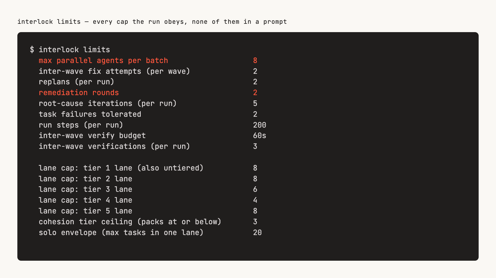

# 07 — The CLIs: reference and configuration

The plugin puts three executables on your `PATH` — `interlock`, `interlock-graph` and `interlock-run` — plus the `interlock-ship-acp` deprecation shim. Every subcommand runs without a model and without the network, with one named exception ([push notifications](#the-one-network-call-push-notifications)). They exist so that any decision the loop made can be re-run by you, on the same inputs, and give the same answer.

This page is the reference. [06 — Why it works](./06-why-it-works.md) explains why each decision moved out of prose; [04 — When it stops](./04-when-it-stops.md) explains every banner these commands print.

---

## Install the CLIs without the plugin

The CLIs are ordinary Node with zero dependencies, and each is useful on its own — `interlock` gates a CI job, `interlock-graph` indexes a repo for any agent, `interlock-run` drives the ship loop over a non-Claude host. They ship as an npm package as well as a plugin:

```bash
npm install -g @renzrollon/interlock
```

Or without installing anything, using the scope on the `-p` flag and the bare binary name after it:

```bash
npx -p @renzrollon/interlock interlock limits
```

| | |
|---|---|
| **Works from the package alone** | `interlock` (the policy engine), `interlock-graph` (build and query the codebase graph), `interlock-run` (drive the loop over the Claude Code CLI, an ACP agent, Codex or Qwen) |
| **Needs the Claude Code plugin** | `/interlock:spec`, `/interlock:ship`, `/interlock:bootstrap` and every other slash command; the `SessionStart` preflight and the `PreToolUse` guards. The package ships the skill and hook files so a package checkout is still a complete plugin, but nothing runs them without the plugin host |

Keep the npm copy at the plugin's version. The plugin's skills call `interlock` by name, and the copy your shell finds first answers them; `interlock doctor` fails its `cli-version` row when that copy is older than the plugin and names the install command that fixes it ([16](./16-upgrading.md)).

**Four behaviours hold across the commands.**

- **`--version`.** `interlock --version`, `interlock-graph --version` and `interlock-run --version` print the bare version. `interlock version --json` prints `{ "version", "path" }`, the path being the file that answered.
- **An unknown flag is refused, exit 2.** `interlock <sub> --bogus` prints `interlock: unknown flag --bogus for interlock <sub> (CLI <version>)` and the subcommand's usage lines on stderr and exits 2. With `--json` stdout also carries `{ "error", "unknownFlag", "subcommand", "cliVersion" }`. Exit 1 stays the blocked verdict of `gate`, `ready`, `ledger`, `validate` and `run-log check`. The accepted flags per subcommand are code (`lib/cli-flags.mjs`), and `USAGE` documents the same set. `interlock-graph` keeps its permissive parser.
- **Help after a subcommand.** `-h` or `--help` anywhere prints that subcommand's usage lines and exits 0 without running anything. `interlock-run -h` is help too.
- **A change as a positional.** `interlock tasks tick <change> --ids <ids>` and `interlock tasks coverage <change>` read the change from the positional that follows the subcommand, as `run start` does; `--change` wins when both are given.

`interlock run start` also takes `--plugin-root <dir>`: the plugin directory, from which the run reads `.claude-plugin/plugin.json`. `/interlock:ship` forwards it, `run start` raises `CLI VERSION SKEW` when the plugin's version and the CLI's differ, and both are recorded on the manifest and the trajectory.

The plugin manifest, `.claude-plugin/plugin.json`, carries the settings hooks inline and names the rest by path: `workflows` names the ship workflow's folder, `hooks/hooks.json` names the hooks module, and `types` names `types/index.d.ts`, the plugin's type contract. The contract declares the one value the hooks module keeps in the session's state, the launch guard's record (`interlock.ledger`), and `claude plugin validate` refuses a state key the module names that the contract does not declare. Every path the manifest names ships in the npm package; `test/spine/package.test.mjs` fails naming any that the `files` list would leave out. Claude Code 2.1.161 does not know the `types` key: it warns `Unknown field 'types'` and ignores it at load time, the settings hooks still run, and only `claude plugin validate --strict` turns that warning into a failure.

---

## `interlock` — the deterministic spine

Each subcommand replaces a judgement the model used to re-derive in prose on every run, usually inconsistently. Every gating command exits 1 when it blocks, so the workflow branches on exit status rather than on parsed prose. `interlock --help` is the authoritative list; this table says what each one decides.

| Command | Decides |
|---|---|
| `interlock waves` | Wave order, the model a lane dispatches on, a **hard cap on parallel agents**, and whether two tasks in one wave would edit the same file. `--mode solo\|waves` forces the plan shape. `--plan <file>` renders a stored plan instead; `--format board\|mermaid` draws it, with `--state <file>` as an overlay and `--columns <n>` as the width ([below](#drawing-a-plan-and-a-run---format-boardmermaid)) |
| `interlock surface` | Whether a diff touches UI, and therefore needs a manual test plan |
| `interlock gate` | Whether a review blocks, which findings are too weak to report, and how the rest partition for parallel fixers. Reads a list of findings, per-dimension records, or the record `interlock review --json` prints (its `surviving` list); an input with no findings list exits 1 ([below](#findings-inputs-what-gate-review-and-remediate-accept)) |
| `interlock review` | Which findings survive two skeptics, and how many were dismissed versus dropped as too weak. Reads the repo-root `REVIEW.md` and drops findings on its do-not-report paths. Refuses a findings input that carries no findings list, as `gate` does. `--base <ref>` reads those paths from the commit at the ref instead of the working tree, and checks a finding's `requirement` citation against the spec at the ref ([below](#reading-policy-and-specs-from-a-base-ref---base)). `--out <file>` also writes the JSON it prints, `--head <sha>` records the reviewed commit as `head`, and `--dimensions <file>` records which dimensions ran and which were skipped ([below](#the-review-record-review---out---head---dimensions)) |
| `interlock review-policy` | What the repo-root `REVIEW.md` actually says once parsed — owner, advice, both path lists (`## Do Not Report` and `## Always Human Review`), and any parse problems. `--base <ref>` reads the two lists from the ref and says whether the working copy differs. See [12](./12-repository-review-policy.md) |
| `interlock remediate` | What gets fixed, what gets deferred, and when the round budget is spent. Reads the same findings inputs as `gate`, and refuses one with no findings list the same way |
| `interlock verify` | What to run (`plan`; with `--context inter-wave --json` it also prints `budgetSource`, saying whether the budget came from the test profile's `unit.timeout_ms`, from the published floor, or from `--budget-ms`), what a red result means (`judge`, `unit`), which failures share a root cause (`cluster`), and whether to repair, halt or accept next (`repair`). `verify judge --head <sha>` records the commit the verdict describes as `head`. `verify baseline` records a coverage report's project total for a commit, and `verify coverage` prints the coverage input the merge verdict reads ([below](#coverage-interlock-verify-baseline-and-verify-coverage)) |
| `interlock wave-state` | What happens next in the wave loop, and when to stop |
| `interlock plan` | Whether a stored wave plan may be reused for this change (`reuse`), keyed on a fingerprint of its planning inputs (`fingerprint`) |
| `interlock merge-lanes` | Whether a batch's isolated lane worktrees fold cleanly back into the shared tree (`--isolate-waves` runs only). A real path collision is a halt naming the path and both lanes, never a guess |
| `interlock paths` | Which paths a commit actually touched (`touched`) and which the plan predicted (`predicted`). Always exit 0; an unreadable set is reported unobserved, never as empty |
| `interlock risk` | How dangerous a change is, from its paths and artifacts |
| `interlock drift` | Which completed changes were never archived, which specs cite files that are gone, and which changed files no spec describes |
| `interlock conformance` | Which spec scenarios a change must be checked against — the questions, never the verdicts. `--living` adds the living requirements already in force for the capabilities the change touches, read from `--base` when one is named ([below](#the-conformance-checklist-interlock-conformance)) |
| `interlock domain-context` | Which living capabilities a diff is judged against by the `domain` review dimension, and the bounded text of their requirements in force. Always exits 0 on a completed report; a skip is stated, not failed ([below](#the-domain-dimensions-input-interlock-domain-context)) |
| `interlock spec-audit` | How much domain contract each living capability carries: requirements, scenarios, bound and prohibition lines, failure and edge-case scenarios, numeric literals, broken file links, and coverable source no spec names. Gates nothing and always exits 0 ([below](#the-spec-audit-interlock-spec-audit)) |
| `interlock merge-confidence` | Whether a change can merge: `MERGE`, `HUMAN` or `BLOCK` from the worst band over every merge signal, a score bounded by that band, and what would lift each signal that is not green. `HUMAN` exits 0. Names the commit and the base it assessed, prints the labels for its verdict, and with `--markdown` prints the description block for a merge request ([below](#merge-confidence-interlock-merge-confidence)) |
| `interlock mr` | The deterministic half of `/interlock:mr --review`: `comment` and `replies` render the findings comment and the reply table under one finding identity, `remediate-brief` briefs a fix-only round under the ship loop's stop rule, `test-paths` names the changed paths the test guard protects, `conformance-brief` prints the confirmation checklist for the head. Offline; it reads the files it is handed and never calls `gh` or `glab` ([below](#the-merge-request-loop-interlock-mr)) |
| `interlock pipeline` | What state each of a platform's checks is in, for the pipeline input `merge-confidence --pipeline` reads: the state tables for GitHub and GitLab are code, so nobody transcribes a check's state. Offline; it reads the document it is handed ([below](#the-pipeline-input-interlock-pipeline)) |
| `interlock ready` | Whether a change may skip the human checkpoint — fail-closed. See [05](./05-continuity.md) |
| `interlock ledger` | Whether the decision ledger still holds an unanswered product question |
| `interlock validate` | Whether a change is actually implementable |
| `interlock changes` | Which OpenSpec changes are active |
| `interlock tasks` | Whether the wave plan covers every unchecked box (`coverage`), and which ids may be ticked (`tick`) |
| `interlock run-log` | Whether a finished run's trajectory can actually be replayed (`check`), and what it recorded (`list`, `show`, `query`). `show --format board\|mermaid` draws the run as a handoff graph |
| `interlock run` | The whole ship loop, as steps: every briefing and every branch a driver obeys next. `run close` is the only step that exits non-zero — on a halt, or on a run that cannot be reconstructed |
| `interlock doctor` | Whether the host can carry an unattended run: the permission allowlist against the commands the flow shells out to (including the one your own `.claude/testing/profile.json` names), the Node version, the installed plugin's workflow and agent types, the OpenSpec CLI, git, and whether the run-state directories can be written — each one where it lives, so from a linked worktree the trajectory directory is probed in the main checkout. Exits 1 when a check would stop a zero-touch run, prints the settings snippet that fixes it, and changes nothing itself. Its `state-home`, `claude-bare`, `advisor` and `mods` rows are advice and never fail — see the note under this table |
| `interlock limits` | Every cap the loop obeys, so nothing restates one. Its last line adds the concurrency observed on this machine beside the vendor default: `CLAUDE_CODE_WORKFLOW_MAX_CONCURRENT_AGENTS=<n>` when set, otherwise the vendor default and the CPU count that may reduce it. `--json` carries it as `runtime.observed` |
| `interlock notify` | The one outbound request this CLI makes — see below |
| `interlock evals` | Whether an eval results file shows a regression (`triage`), whether a case may move from advisory to blocking (`promote`), how often judged graders agreed with human labels (`calibrate`), and a draft case from a recorded run (`capture`). See [14](./14-evals.md) |
| `interlock report` | Indicators over the three recorded corpora, read from the state home, every value with its denominator. Gates nothing, always exits 0. See [11](./11-the-indicators.md) |
| `interlock outcomes` · `interlock autonomy` | Record a run's outcome, and per-path outcomes for the earned-autonomy ledger. **Nothing reads either to change what the workflow does**: no autonomy level and no accumulated outcome ever relaxes a gate. They exist so the question can be answered later, from evidence |

`--json` on any command emits JSON instead of prose. Any `<file>` argument accepts `-` to read that input from stdin.

Some of `interlock doctor`'s rows are advice, `ok` or `skip` and never `fail`, on the same posture as its `prompt-cache` row. **`state-home`** names the home this root's corpora go to and what the root is — a main checkout, a linked worktree, one of Interlock's lane worktrees — or `skip` with the reason when it could not tell ([the state home](#where-a-runs-records-go-the-state-home)); `doctor --json` carries the resolved `stateHome`, which the SessionStart preflight reads interrupted-run notes from. **`claude-bare`** says whether a bare `claude -p` would have a credential to run on: `ok` when `ANTHROPIC_API_KEY` is set (checked by name, never printed) or an `apiKeyHelper` is configured in a settings scope, `skip` otherwise. It exists because Claude Code's headless docs recommend `--bare` and say it will become the `-p` default, and under it OAuth and the keychain are never read: `--host claude` lanes would then need a key or a helper, and a plugin would load only through `--plugin-dir`. Nothing changes for a run today. **`mods`** says whether the probed `claude` can load the plugin's hooks module, the ship meter and the in-process form of the launch guard ([13](./13-the-guards.md#two-forms-and-which-is-active)): `ok` from Claude Code 2.1.287, `skip` below it or with the version unknown. It names the binary it read (`claude` on PATH, or `INTERLOCK_CLAUDE_COMMAND`), because the engine behind a Desktop Code tab is not that binary; the meter itself logs the engine it loaded in at session start. A host that cannot load mods runs exactly today's run and prints every banner at close. **`advisor`** says whether Claude Code's advisor tool is configured, by scope ([the advisor tool](#claude-codes-advisor-tool)).

### The conformance checklist: `interlock conformance`

`interlock conformance [change] --changed <files...>` lists the change's own delta-spec scenarios as questions, `C1..Cn`, each with the artifact and line it is written at. It decides nothing: whether a scenario is satisfied is for the handoff step to answer and for a person to read. It exits 0 in every case, and its output ends by saying nothing in it blocks.

- **`--living`** adds, after the scenarios, the living requirements already in force for the capabilities the change touches: `L1..Ln`, each with its capability, the living spec's path and the line of its heading, never its body. The capabilities, the text and the size bound are the ones `interlock domain-context` gives the `domain` reviewer, so the reviewer and the handoff cannot be judged against two different sets. A requirement the change's own delta specs modify, remove or rename is not listed, because its own scenarios answer for it. A requirement past the bound is named as left out and none is cut part-way; the bound is the `domain spec text budget (chars)` row of `interlock limits`. The count of listed entries is the only denominator a reader may use.
- **`--base <ref>`** with `--living` reads the living text from the commit at the ref instead of the working tree, and the output names which it read. A ref that names no commit is reported as the reason the living list was not built, the scenarios are still listed, and the command still exits 0.
- **A list that cannot be built says why.** With no graph and no capability the change declares, the list is *skipped*; with no graph and at least one declared capability it is *partial*, built from the declared capabilities only; a graph that links none of the changed paths gives an empty list that is neither. `--json` carries the block as `living: { requirements, requirementsRequired, omitted, source, skipped, partial }`.
- **Without `--living` the output is what it was before the option existed.**

A ship run built with `--conformance` asks the handoff step about the same list, and the merge verdict's `conformance.living` signal reads the answers ([15](./15-merge-confidence.md#confirming-living-requirements-at-handoff)).

### Merge confidence: `interlock merge-confidence`

`interlock merge-confidence [change] --changed <files...>` answers "can this be merged?" with a verdict (`MERGE`, `HUMAN` or `BLOCK`), a score, and one entry per registered signal carrying its band (`green`, `amber`, `red` or `unobserved`), its flags, its evidence and its reason. The verdict is the worst band over the gating signals: any red is `BLOCK`, every signal green is `MERGE`, anything else is `HUMAN`, and an unobserved signal ranks as amber. No number of green signals lifts one amber or red. A flag (`no-e2e`, `no-coverage`, `no-graph` and the rest of the published list) lowers the score and never moves a band. The score sits inside the worst band's range, positioned by the share of gating signals that are green with no flag, so a red never outscores an amber and two changes in one band still sort. Every entry in `driving` says what would lift it: a person, more evidence, or a fix. `--json` carries `verdict`, `score`, `worstBand`, `signals`, `driving`, `counts` and `flags`, and three fields that say what the verdict is about and how to show it:

- `head`: the assessed commit as `{ sha }`, or null when the head cannot be read.
- `base`: `{ ref, sha }`, the reference given and the merge base the diff was taken from. `sha` is null when the reference resolves and its merge base cannot be read (a shallow clone); `base` is null with no `--base`.
- `labels`: the labels for a merge request. `verdict` and `score` are each `{ name, color, description }`; `verdictNames` lists the three verdict label names and `scorePrefix` the prefix of every score label, so a caller can recognise the labels a merge request already carries. The names are defined once, in the CLI ([15](./15-merge-confidence.md#the-description-block-and-the-labels)). The text output prints the two names on one `labels:` line.

**`--markdown`** prints the description block for a merge request and nothing else: the verdict line, a legend line, the commit and the base, what is driving by kind, the flags, the checks excluded from the pipeline input, the two labels, and every signal in a collapsed table. Every reason, evidence line and excluded name is an inline code span, so no name a platform, a review or a ledger supplied renders as a mention, a link or markup. The exit status is what it is without the flag. Together with `--json` it is a usage error: exit 1, nothing on stdout. **The legend line** appears directly under the verdict line in every verdict, in the same words: `MERGE` means every local signal is green, and is not a statement that the platform's branch rules would let the merge request merge. It names required checks, required approvals, code owners, a draft state, unresolved review threads and a merge queue as rules the verdict does not read ([15](./15-merge-confidence.md#the-description-block-and-the-labels)).

**`--label-names`** prints how to recognise the labels and assesses nothing: the three verdict label names and the score label prefix, as `labels: { verdictNames, scorePrefix }` with `--json`. It reads no input and no repository and exits 0, so it answers when an assessment could not run and a caller has an earlier assessment's labels to remove. Together with `--markdown` it is a usage error.

**Exit codes.**

- `0`: the verdict is `MERGE` or `HUMAN`. A change that needs a person is not a failed command, so a CI job that only wants a label does not go red on it.
- `1`: the verdict is `BLOCK`, or, with `--require-merge`, anything but `MERGE`.
- `1` with nothing on stdout: an input could not be read or parsed, a `--pipeline` file is not well-formed, or `--markdown` was given with `--json`. The reason is on stderr and names the file, exactly as for `interlock gate`. Exit 1 alone does not tell this from `BLOCK`; a verdict on stdout does.

**Inputs.** The command gathers what the repository says for itself: its decision ledger, its delta-spec scenario count, which is the conformance denominator and which no input can shrink, the living-requirement list, which is the denominator of the living half and which no input can shrink either, drift narrowed to what this change did, `HEAD`, and, with `--base <ref>`, the diff shape from `git diff --numstat <ref>...HEAD`, the review policy committed at the base and the spec-coverage facts. The living list and the spec-coverage facts are gathered from the repository, by the same code the ship run's close calls, so the command and a run's close read one input; the spec-coverage facts come from spec text and need no graph. A fact the gather cannot read (a diff git cannot compute, a file that is not there at the base) is named on stderr, one line each, and its signal reads `unobserved`. With a base, every path that diff reports is assessed as a changed path whether or not `--changed` names it, and the ones it left out are listed on stderr, so leaving a path out of `--changed` cannot keep it from the risk classifier. A base that is `HEAD` or ahead of it diffs empty by construction, so the diff shape reads `unobserved` rather than small. With no change named it assesses the single active change, and with none it says so on stderr. Everything else is a file the caller names:

| Option | What it holds | Who produces it |
|---|---|---|
| `--review <file>` | The adjudicated review: surviving findings with their votes, the counts, and an optional dimension record. An optional string `head` binds it to a commit | `interlock review --json`, `interlock review --out`, or the `review.json` a ship run writes |
| `--verify <file>` | The final verification verdict, including its `typecheck` field and an optional `head` | `interlock verify judge --context final --head <sha> --json` |
| `--handoff <file>` | `scenariosChecked` and `scenariosUnconfirmed`, and, for the living list, `requirementsChecked` and `requirementsUnconfirmed`. A `verdictsRequired` or a `requirementsRequired` in the file is ignored: each denominator is the command's own count. An optional `head` binds it to a commit and is stripped before the counts are read | the ship run's handoff step, or the worker `interlock mr conformance-brief` briefs |
| `--pipeline <file>` | `{ sha, checks: [{ name, state, required }], excluded }` for the head commit, `state` one of `pass`, `fail`, `pending`, `skipped` | `interlock pipeline`, from the platform's own output ([below](#the-pipeline-input-interlock-pipeline)) |
| `--coverage <file>` | `{ configured, headTotalPct, baseTotalPct, baseSha, baseIsAncestor, diffPct, changedLines, unreportedFiles, unreportedAddedLines }` | `interlock verify coverage --base <ref> --json` ([below](#coverage-interlock-verify-baseline-and-verify-coverage)) |
| `--run <file>` | The five inputs only a run observed (the review, the verification verdict, the handoff counts, the coverage figures and the run record), taken together from one file | the `.claude/ship/merge-confidence.json` a ship run's close writes ([15](./15-merge-confidence.md#the-runs-evidence-file-and---run)) |

**`--run` is conditional.** The file is used only when it carries its schema identifier, names the change under assessment, records that the run made a commit, and records the head commit as that commit. With `--base` there is a fifth condition, applied after those four: the base the file records must be the merge base of `--base` and the head, because a run's evidence covers the diff that run reviewed and no other. A file whose base differs, a file that records no base, and a merge base git cannot give (a shallow clone; the reason names fetch depth) are each refused. When any of these does not hold, nothing is taken from it, stderr says which condition failed, naming both diffs for the fifth, and every signal reads as it would with no file. No base is ever taken from the file: pass `--base` with `--run`, or the signals that need a base stay unobserved and the verdict cannot be `MERGE`. An explicit `--review`, `--verify`, `--handoff` or `--coverage` replaces the file's entry for that input. **A descendant of the run's commit** supplies only the run record: when the head descends from the recorded commit and, with `--base`, the file's base equals the merge base, the review, verification, handoff and coverage entries are dropped (stderr names the commit the record was carried from and each dropped entry) and the run's record of its own conduct is kept. The ancestry is three-valued. A commit that is not an ancestor is refused with the "describes another commit" reason; an ancestry git could not decide (a recorded commit missing from a shallow clone) is refused with its own reason, that the ancestry could not be decided. **A record that names its head** (`--review`, `--verify` or `--handoff` carrying a string `head`) is used only for that head; another commit's is refused on stderr, in the same words, and its signals read as with no file. A record with no `head` is read as before ([15](./15-merge-confidence.md#the-runs-evidence-file-and---run)). The verdict recorded in the file is never read: the command always reassesses from the evidence. A file that cannot be read or parsed exits 1 with nothing on stdout, as any other unreadable input does.

An input not given reads `unobserved`, and its reason names the option that would supply it. A pipeline file for another commit is unobserved rather than red, even when it records a failed required check: the head may have fixed it. The evidence still names that check.

**The pipeline file is validated before anything is assessed.** It is accepted only when it is well-formed by the one rule `lib/pipeline.mjs` publishes: an object with a string `sha` and a list `checks` in which every entry has a non-empty `name`, a `state` that is one of the four, and a boolean `required`; an `excluded` list of names may be present. Any other file exits 1 naming the fault, with nothing on stdout. An absent or misspelt `checks` is never read as "no checks": an explicit empty list says that, and reads green with the `no-pipeline` flag. Checks the caller excluded are named in the signal's evidence whatever its band.

**`risk.class` reads the changed paths only.** The change's artifact text is not read at merge, and documentation and test paths are outside the classifier's severity path rules. A signal that has only a text rule (`idempotency`) therefore cannot fire at merge, so a diff whose only critical clue was that word in a design document reads the unmatched-source class. `interlock risk`, the continuity gate and the spec-stage checkpoint keep reading both sources. This is a behaviour change of the verdict, reversible at one call site ([15](./15-merge-confidence.md#the-risk-signal-at-merge)).

**Offline.** The command reads the repository, the files named and the published limits. It never calls `gh`, `glab` or the network, so a CI job on a plain checkout can run it with no platform credential.

**`policy.humanPaths` is observable with `--base`.** The always-human-review list is read from the `REVIEW.md` committed at the base ref, never from the working copy, as GitHub reads `CODEOWNERS` from the base branch. The signal is amber, needing a person, when a changed path lies under a listed prefix (each such path is named), when the working copy of `REVIEW.md` differs from the base's, or when the base's always-human-review section has a parse problem; it is green otherwise. Several holding at once produce one amber whose evidence lists all of them. Without `--base` the signal reads `unobserved` and says `no --base was given`. [12](./12-repository-review-policy.md) has the section's rules and why the lists are read from the base.

**Every gating signal has a producer.** A clean, reviewed, verified change can read `MERGE`: it needs a green band for every gating signal, so it needs `--base` (the diff shape, the human-paths list and the spec-coverage facts are unobserved without one), the run's evidence (`--run`, or `--review`, `--verify`, `--handoff` and `--coverage` by hand) and a passing pipeline for `HEAD` (`--pipeline`). A signal reads `unobserved` only because a fact about this change is missing, and its reason says which; no reason says an absent capability keeps `MERGE` out of reach. A ship run's close supplies no pipeline, so a close reads `HUMAN` or `BLOCK` and the first `MERGE` comes from this command with the pipeline added. The `domain` review dimension's skip is carried as the `domain-skipped` flag when the review file names it, and a living list the size bound cut short is the `requirements-omitted` flag; both lower the score and never move a band. The command also writes nothing: the ship loop records its own verdict at close ([15](./15-merge-confidence.md#what-a-runs-close-records-and-prints)).

The three rows below are the signals whose producers this release completes. The others keep the rows and reasons they had.

| Signal | Reads | Band |
|---|---|---|
| `conformance.living` | The handoff's `requirementsChecked` and `requirementsUnconfirmed` against the number of entries in the living list the command counts itself | `unobserved` when no list was gathered, or when the list has entries and no handoff was given. Green when the list is skipped for want of a graph (flag `no-graph`) or holds nothing to confirm. Amber, needing more evidence, when either count is missing, any requirement is unconfirmed, or the number checked differs from the number counted. Green when every listed requirement was checked and none is unconfirmed. `no-graph` is added when the list was built from declared capabilities only, `requirements-omitted` when the bound left any out |
| `spec.coverage` | Whether each coverable source file the diff adds is named by a living spec at the head or one of the change's delta specs, and whether a kept file lost the only spec that named it. Spec text only, never the graph | `unobserved` with no base, and when the diff is empty by construction. Amber, needing a fix, for an added file nothing names or a kept file whose naming spec the diff changed or deleted. Green otherwise; an edited file nothing ever named is the `legacy-unspecced` flag and moves no band |
| `run.integrity` | The run record: whether the run halted, whether the trajectory is complete, the stage markers not published, the handoff reports rejected, the permission prompts and auto-mode denials, and the tasks left unticked | `unobserved` outside a run, with no record, and when the record lacks any of those observations or carries one as null: the reason names each by its record key. Amber, needing a person, for any recorded degradation, a run that left tasks unticked among them, whatever else is absent. Green only for a record that carries every observation, none a degradation |

**Flags.** The published list is `no-e2e`, `no-typecheck`, `no-coverage`, `no-baseline`, `no-pipeline`, `docs-only-changes`, `dimensions-unrecorded`, `domain-skipped`, `blast-radius-skipped`, `legacy-unspecced`, `no-graph`, `requirements-omitted` and `unmeasured-source`. `blast-radius-skipped` is raised by `review.ran` when the review's dimension record names the `blast-radius` dimension as skipped (no graph), like `domain-skipped`. `requirements-omitted` is raised by `conformance.living` when the size bound left living requirements out of the list the handoff was asked about, a list cut to nothing included; its evidence states how many were asked and how many were left out. `unmeasured-source` is raised by `verify.coverage` on a green reading when the coverage input names changed source files the report does not list; the evidence names the files and the lines the diff adds in them, on any reading. A flag lowers the score and never moves a band. [15](./15-merge-confidence.md#the-flags) has one row per flag, and [its signal table](./15-merge-confidence.md#the-signals) one row per signal.

Reasons that apply a number name it as `MERGE_BANDS.<name> = <value>`; read `interlock limits` for the figure and never this page. [15](./15-merge-confidence.md) says how to read each of the three.

**Thresholds.** Every number the verdict applies is a merge-band row of `interlock limits`: the green, amber and red band ceilings (unobserved takes amber's range), the cap on surviving warnings, the skeptic verdicts each surviving blocker or warning needs, the coverage decline tolerance, the patch-coverage floor used when there is no baseline, the small-change floor below which coverage is not judged, and the two diff-size caps. `interlock limits --json` publishes them as `mergeBands`. A reason that applies one names it as `MERGE_BANDS.<name> = <value>`; none is restated here. The one cap this page's commands add is not a merge band: the budget for the living-requirement text the `domain` reviewer is handed is the `domain spec text budget (chars)` row of `interlock limits` (`LIMITS.maxDomainSpecChars`, beside the handoff and policy-size caps), because it bounds a prompt and decides no verdict.

### Coverage: `interlock verify baseline` and `verify coverage`

The coverage signal needs two figures the CLI now computes from an lcov report: the project total, and the share of the diff's added lines that the report instruments and covers. Neither subcommand runs your tests; `verify exec` stays a pinned pass-through and adds nothing to a command's output. [15](./15-merge-confidence.md) has the recipe for recording a baseline on the default branch.

- **`interlock verify baseline [--report <lcov>] [--baseline <file>] [--json]`** writes `{ schema, sha, ref, totalPct, generatedAt }` for the current commit, to `--baseline` or to `.claude/testing/coverage-baseline.json` in the working root, never the state home. Without `--report` it reads the test profile's `coverage.report_path` resolved under `unit.cwd`. A report that cannot be read, or instruments no line, has no total: exit 1, and any previous baseline is left untouched.
- **`interlock verify coverage --base <ref> [--report <lcov>] [--baseline <file>] [--compute-base] [--json]`** prints exactly the `--coverage` input above and never a band. `--base` is required, because the diff against it is the changed-line figure. `unreportedFiles` lists the changed source files the report holds no record for: a file the diff adds at least one line to that the project counts as coverable source, never a test, a configuration file or a document. `unreportedAddedLines` is the lines the diff adds in them. The changed-line figure still counts only lines the report instruments, so naming those files moves no figure. Both are null when coverage is not configured. A profile with no coverage command prints `configured: false`. The baseline is `--baseline`, else the working root's, else the state home's; `baseIsAncestor` is `git merge-base --is-ancestor <baseline sha> HEAD`, and a baseline whose commit is not an ancestor (or is missing from a shallow clone, which the stderr line says) reads as not an ancestor. A report format other than `lcov` exits 1 naming the one supported format.
- **`--compute-base`** applies only when no usable baseline exists. It checks the merge base out in a temporary worktree, runs the profile's coverage command there, records the total as the baseline and uses it. The worktree is removed whether the command passed or not, a failed measurement exits 1 naming the command, and the worktree holds no gitignored files and no installed dependencies, so a command that needs them fails there. The default-branch job in [15](./15-merge-confidence.md) is the supported route.

### The pipeline input: `interlock pipeline`

`interlock pipeline` turns a platform's own check output into the file `merge-confidence --pipeline` reads. It is offline: it reads the JSON document it is handed, from a file or from stdin (`-`), and never calls `gh`, `glab` or the network. The input carries names and states only, never a check's link, description or log.

```
interlock pipeline --github <file|-> [--required <name>]... [--exclude <name>]... [--out <file>] [--json]
interlock pipeline --gitlab-mr <file|-> --out <file> [--json]
interlock pipeline --gitlab <file|-> --mr <file> [--exclude <name>]... [--out <file>] [--json]
```

- **`--github`** reads what `gh pr view <n> --json headRefOid,statusCheckRollup` prints: the head commit and its checks in one document. `--required <name>`, repeatable, marks the check of that exact name as required; a name that matches no reported check becomes a pending, required entry, and with none given stderr says the required set was not given.
- **`--gitlab-mr`** reads what `glab mr view <iid> --output json` prints and needs `--out`. With no head pipeline it writes a complete input with no checks. With one it writes a pending record, `{ sha, headPipeline }`, which is not a pipeline input: `merge-confidence` refuses it if the next step never runs.
- **`--gitlab`** reads what `glab ci get --merge-request <iid> --output json` prints, and the record `--mr` names (which may be the path `--out` names). The input takes the record's head commit, so nobody types one. A pipeline that is not the record's, or a branch pipeline that ran on another commit, exits 1 naming both.
- **`--exclude <name>`**, repeatable, leaves the check of that exact name out and records it under `excluded`. No character is special: a name that matches nothing is said on stderr and not recorded.
- **`--out <file>`** writes the input, creating the directories above it. `--json` prints the input instead of the summary line `pipeline <sha>: <n> check(s) (… pass, … fail, … pending, … skipped); required: …; excluded: …`, or `pending <sha>: head pipeline <id>` for a pending record.

It exits 1, with nothing on stdout, on a document that is not JSON or is not the one the platform flag expects, a missing `--out` or `--mr` where one is required, a pipeline that is not the record's, and a branch pipeline for another commit. **When it produces no input, it removes an earlier file at `--out` and says so on stderr**, so an earlier moment's checks are never left where the next command would read them. The state tables are in `interlock --help` under `pipeline:`, and [15](./15-merge-confidence.md#the-pipeline-input-interlock-pipeline) says why each rule is what it is, including that the GitLab reader is written from documentation and has not been run against a live project.

### Findings inputs: what `gate`, `review` and `remediate` accept

A findings input is one of four shapes: a list of findings; a list of per-dimension records, each `{ dimension, findings }`; one such record; or the record `interlock review --json` prints, from which the `surviving` list is read. `interlock gate` handed a review record therefore blocks on its surviving blockers, and `interlock remediate` plans from the same list.

Any other input carries no findings list, and none of the three counts it as zero findings: each exits 1 with the reason on stderr and nothing on stdout, as it does for a file it cannot read. **An empty list is how to say nothing was found**; an object such as `{}` is not. `interlock ready` reads a findings file with no list as an artifact review that has not run, which is not ready. A ship run applies the same rule to its own work files ([04](./04-when-it-stops.md#a-review-or-a-round-that-left-no-findings-list-and-review-work-file-not-cleared)).

### Reading policy and specs from a base ref: `--base`

`--base <ref>` is the same flag everywhere it appears (`merge-confidence`, `review`, `review-policy`, `domain-context`, `verify coverage`), and it is guarded the same way: a bare `--base` exits 1, a value starting with `-` exits 1, and a ref that names no commit exits 1 with nothing on stdout.

- **`interlock review --base <ref>`** and **`interlock review-policy --base <ref>`** read `REVIEW.md`'s two enforced path lists, `## Do Not Report` and `## Always Human Review`, from the commit at the ref, so a change cannot quiet the review of its own paths by editing the copy applied to it. The prose stays the working tree's, because it is advice that cannot lower survival. `review-policy --json` adds `listsFrom` and `differsFromBase`; a difference is said, not silently resolved. `review` also reads each finding's optional `requirement` (`openspec/specs/<capability>/spec.md#<heading>`) from the spec at the ref and reports a citation that names no requirement under `anomalies.requirementCitations`; the finding is kept.
- **A ship run** records the commit it started on (`startSha` on the run manifest) and reads the lists, and the living requirements, from it. A working `REVIEW.md` that differs raises `POLICY DIFFERS FROM BASE`; a manifest with no start commit reads the working tree and raises `REVIEW BASE NOT PINNED` ([04](./04-when-it-stops.md#policy-differs-from-base-and-review-base-not-pinned)).

### The review record: `review --out --head --dimensions`

`interlock review` gained three options so a review run outside a ship can be passed to the merge verdict as itself.

- **`--out <file>`** writes the same JSON `--json` prints, creating the directories and removing an earlier file first. A write that fails exits 1 naming the file and prints nothing.
- **`--head <sha>`** records the reviewed commit as `head`. `merge-confidence` then uses the record only for that commit.
- **`--dimensions <file>`** names the record `review-code` writes beside its findings: `{ selected, ran, unavailable, skipped: [{ name, reason }] }`. It is validated before anything is written (arrays of strings; a `skipped` entry carries a string `name` and `reason`), and any fault exits 1 naming the file and the key. It is recorded in the output as `dimensions` with `completed: true`. Without it the output carries no dimension record and `review.ran` reads green with the `dimensions-unrecorded` flag. A skipped `blast-radius` or `domain` dimension in it reaches the verdict as a flag.

`interlock verify judge --head <sha>` does the same for the verification verdict: it records `head` on the verdict.

### The merge-request loop: `interlock mr`

`interlock mr` is the deterministic half of `/interlock:mr --create --review` ([15](./15-merge-confidence.md#closing-the-loop-on-a-merge-request) has the loop in order). It lives in its own module, reads the files it is handed through the CLI's JSON-input helper, and never touches the network. A review record without a `surviving` list is refused in the words `merge-confidence --review` uses. `--json` on any subcommand prints JSON.

| Subcommand | Does |
|---|---|
| `interlock mr comment --review <file> --head <sha> --round <n>` | Renders the surviving findings of a head-bound review as one comment, each under a stable id (`F-` plus eight hex characters). An empty list renders a paragraph saying the review ran on the head and found nothing |
| `interlock mr replies --before <file> --after <file> --head <sha>` | Renders each earlier finding as `fixed` (no finding of the later review shares its identity) or `open`, and each later finding the earlier one lacked as `new`. The identity is the trimmed file plus the title, whitespace collapsed, case folded, trailing `.`, `:`, `;` and `!` stripped |
| `interlock mr remediate-brief --review <file> --round <n> --change <name> --head <sha> [--pr <n>] [--protected <paths>] [--result <file>]` | Prints the fix-only briefing for one round, built from the same `planRemediation` the ship loop uses and under its stop rule and the published `remediationRounds` cap. Exits 1 with the reason on stderr and nothing on stdout when there is nothing to fix or the plan halts: that exit ends the loop |
| `interlock mr test-paths --changed <files\|->` | Prints `{ protected, unprotected, profile, reason }` with the test guard's own predicate. `-` reads one path per line from stdin. With no test profile, `protected` is empty and `reason` says so |
| `interlock mr conformance-brief <change> --changed <files\|-> --base <ref> --head <sha> [--result <file>]` | Prints the confirmation briefing from the checklist `interlock conformance --living` builds, asking for the five handoff keys and `head`. When the living list cannot be built it says why. With nothing to confirm it prints nothing, says so on stderr and exits 0 |

The eighth review dimension, `blast-radius`, and its recorded skip are described in [12](./12-repository-review-policy.md#the-blast-radius-dimension-and-its-recorded-skip).

### The domain dimension's input: `interlock domain-context`

`interlock domain-context [change] --changed <files> [--base <ref>] [--json]` prints what the seventh review dimension, `domain`, is handed: the capabilities selected, how each was selected, and the text of their living requirements in force. A capability is selected when a reliable graph edge links a changed path to its living spec (`linked`), or when the change's own delta specs modify it and its living spec exists (`declared`). A requirement the delta spec modifies, removes or renames is dropped from the text, and whole requirements are added in order until the published budget is reached; what is left out is named, never silently cut. With no `--base` the working tree is read, and the output says so. The graph is found in the root, then the state home. No graph and nothing declared is `SKIPPED`; no graph with something declared is `PARTIAL`; a graph that links none of the changed paths records them as not selected, which is neither. It exits 0 on a completed report and 1, with nothing on stdout, on a `--base` that names no commit. The ship run assembles the same text itself ([10](./10-agentic-workflow-ship-and-spec.md#the---strict-sequence)); the `review-code` skill runs this command before fanning out.

### The spec audit: `interlock spec-audit`

`interlock spec-audit [--json]` walks `openspec/specs/**/spec.md` and counts, per capability and in total, what the living specs state: requirements, scenarios and those lacking a `GIVEN` line, failure and edge-case scenarios by the corpus's title convention, lines carrying a bound or a prohibition, and numeric literals in requirement prose for a person to classify. With a graph it adds the coverable source files no living spec names and the spec links that name a file that no longer exists; without one those measures are reported absent with that reason, never as zero. A spec it cannot read is named and left out of the totals. It is a report in the `drift` family: it gates nothing and always exits 0. [15](./15-merge-confidence.md) says how to read it.

### Drawing a plan and a run: `--format board|mermaid`

Two commands draw what a run already records, and decide nothing.

- **`interlock waves --plan <file> --format board`** draws a plan as a wave board: one bordered block per wave, one row per lane (its batch, its label, its model, tier and effort, the ids it was ordered after, and the first words of its first task), a verify cell between waves, and a tail naming the gates after the last wave. A lane's row carries its label (`1.1`, `1.1+2`), the name its briefing file, its worktree and its trajectory line carry; its spawn is shown under the lane's title, the same label after `task` or `tasks`. **`--format mermaid`** draws the same plan as a Mermaid `flowchart LR`, never cut. `--classified <file>` with `--format` draws a plan freshly made instead.
- **`interlock run-log show <runId> --format board`** draws a run as a handoff graph from its trajectory, in sequence order: each CLI ping with its exit code and duration, each spawned agent, the packets handed from one wave to the next with their audit verdicts, the halt and the receipt. **`--format mermaid`** draws it as a `flowchart TD`.

**The board keys waves by position, never by group.** Dependency layering can emit a later layer under the same section number, so two waves can share a group; each is its own block, headed `wave <n> · idx <i> · group <g>`.

**`--state <file>` lays a wave state over the plan, and every word it adds is one the state recorded.** A lane reads `ok` or `failed` when the state lists its task as completed or failed; `current` at the cursor's wave and batch; `not recorded` before the cursor when the state lists the task nowhere; and after the cursor `pending`, or `not reached` once the run has halted. A skipped verification is recorded by group, not by position: when two boundaries share that group, the verify cell says the state does not tell which boundary the skip belongs to, rather than pick one. A failure whose id names no planned lane is listed under the board, never dropped. A state whose wave count differs from the plan's is applied by task id only, and the header says so.

**The handoff graph states two caveats where they apply.** Implementer spawn times are the time the step was emitted, not when the host started the agent; and a spawn with no recorded result reads `result: not recorded`, never as finished. Its state and manifest come from the state home beside the trajectory, and only when they name the run; otherwise the header reads `absent`, `unreadable` or `another run <id>`.

The board's narrowest width and its width when neither `--columns` nor a terminal says are printed by `interlock limits` as `wave board min width (columns)` and `wave board default width (columns)`; below the minimum the board is one line saying so. `--format` is a surface of its own and refuses `--json`, as `report --html` does. A plan, state or trajectory that does not exist is spoken (`no plan at <path>`, `no state at <path>` beside a plan-only board, or the line `run-log show` prints for a run never recorded) and exits 0. `docs/10` carries [one generated block](./10-agentic-workflow-ship-and-spec.md#the-plan-drawn).

### The ship meter: `/interlock-meter`

On a host that loads mods (Claude Code 2.1.287+), an interactive session that launches `/interlock:ship` gets the run drawn live, in a terminal and in the Desktop Code tab:

- **A status line**: `interlock: <change> · <action> · wave <w>`, plus `batch <j>/<k>` where the step carries a batch position. The batch position shows on the Workflow host too: the relay that slims a step for that host carries the wave and batch positions. Under an older `interlock` that relays none, the line shows the wave alone. While the run is quiet, ` · quiet <n> min` follows (below). It is cleared at the close or a halt.
- **A toast per degradation banner**, the moment the step that raised it crosses, once per banner text.
- **A toast when the host ends a run agent's turn without an answer**: `<lane> · agent <id> · turn ended: <reason>`, once per agent per run. The reason is the host's own word, repeated verbatim (`aborted`, `refusal`, `error`, or any word a later host sends), and nothing is added to it. `<lane>` names the agent as the pane does: its lane's title (`task 1.1 · Add the relaunch guard`, or `tasks 1.1+2 · …` for a lane of several tasks) or a non-lane worker's label (`plan-waves`, `verify`, `commit`) once the agent is joined to its row, `cli · run next` for a relay ping, and `unmatched agent` before either. The Workflow host raises no spawn event for a workflow agent, so the meter joins each one on the first thing it does: it reads its briefing, `.claude/ship/briefings/<label>.md`, with `Read` or a Bash `cat`, and the path names the spawn. A relay is known by its own `interlock …` line. An agent seen doing neither stays `unmatched agent`, and the pane says why under its agent rows. The meter fires it only when the host reports such an end. A lane the session stopped with `TaskStop` reads `aborted`. The close summary's `AGENT RETURNED NO RESULT` banner stays the record: the driver hands it to the CLI only at the close, so the meter sees it then and not before.
- **A toast when a guard refuses a call**: the guard's own sentence, from its name on (`guard-tests: …`, `guard-tasks: …`, `guard-commit: …`, `guard-relaunch: …`), once per distinct text per run, read off the errored result the engine hands back for the blocked call. The blocked agent still receives the same text as its tool error. A denial that names no Interlock guard, and a command that simply failed, raise nothing. The launch guard's refusals, its own and the settings form's, are toasted in any interactive session, run or no run.
- **`/interlock-meter`**, a pane at any width: the change and run id, the current action, when the run started and when it was last active, in your local time (`started <date> <time> · last activity <time>`, with the quiet word beside it when it applies), the wave board (below), the run's timeline (below), the session's context fill and cost as the engine reports them (`context <tokens> of <window> tokens · <n>% used`, and `session cost $<usd>`, labelled as the engine's total for this session, not the run's), the plan windows your session reports (kind, percent used, reset time, with no threshold and no colour), every banner so far, a `refusals` section (`guard denials: <n> (<guard> <n>, …)` once a guard has refused a call this run, and `launch guard: next launch allowed`, `launch guard: next launch refused: <reason>` or `launch guard: facts unreadable; the next launch is allowed`, the launch guard's current ruling, also drawn when no run is live), and after the close the summary the CLI printed, resume card row included. At run start the meter opens it unasked; the engine seats an unasked pane only in a wide terminal, and otherwise one toast names the command.
  - **The wave board** is the pane's `waves` section, the same fields `interlock waves --plan <file> --format board` prints, laid out as one bordered card per wave (capped at the published default width). Inside a card the lanes are grouped by batch: each batch has a line with the time it was dispatched and `N in parallel` (or `1 lane`), and its lanes are indented beneath it, because the lanes of one batch run side by side and the batches of a wave run one after another. Each lane is up to three lines: the fixed cells (label, model, tier, effort, state word, task ids, `←` with the ids it was ordered after), wrapping as one line when the card is narrow; the task title, wrapping; and, once the lane's agent has spawned, what the host reported serving it and, once its turn ended, how long it took, dim. The state words (`ok`, `failed`, `current`, `pending`, `not reached`, `not recorded`, and `per task` for a lane whose tasks disagree, each task's own word then beside its id) are drawn in your theme's success, error and warning colours (`ok`, `failed`, `current`; the rest dim), the lane's label in the theme's identity colour, and the card of the wave holding a `current` lane is bordered in the warning colour while every other card's border stays dim. A `RED` marker in a wave title is the plan's red-test flag and is not coloured. Between cards sit a verify cell per boundary, and the board ends with the `then:` tail. The state words and the verify cells come from the run's own steps: the plan summary the first batch step carries, the ids each recorded batch names, the skipped verifications and the halt. No file is read for them. Agents that are not lanes (a verifier, a committer) are flat rows beneath the board. Two fallbacks say what they are. Under an older `interlock` that relays no plan, the section reads `plan structure not relayed by this CLI` above one flat row per agent (lane, routed model, served model, effort, state), as the meter drew before. In a pane narrower than the board's minimum, the board's one line naming the width it needs stands above those flat rows. `interlock limits` prints both widths as `wave board min width (columns)` and `wave board default width (columns)`.
  - **The timeline** is the run in the order it happened, each line with its local time (`HH:MM:SS`) in a gutter on the left, blank where the clock gave no reading. One line per CLI step as it crossed (`run-batch · wave 2 · batch 1/2 · 3 in parallel`, `verify · wave 2 · skipped: <reason>`), the relay agent that carried it folded into that line (`cli <id>`, its model, its request count and how long it took). The agents a step spawned are indented beneath it in the order they started, each with its name, id, model and turn (`answer 2m 14s`, `running`) and a dim line of its requests and tokens; a spawn no agent has picked up yet reads `waiting`. A relay whose line printed no step stands at its own time, and agents nothing names are listed last under `unmatched`. Durations read `41.2s`, `2m 14s` or `1h 03m`. Each section's body is indented under its heading. The pane is as tall as the engine seats it; scroll its body to read a long run.

**The pane's colours are your theme's.** Every colour is a theme key (`success`, `error`, `warning`, `suggestion` for identity, `claude` for the accent), so the pane follows a light, dark or colour-blind theme rather than fixed ANSI hues. A colour marks what a word already says and adds no verdict of its own: the run header and the section headings in the accent colour; a lane's label and each agent's name in the identity colour, bold; the board's state words as above; an agent's turn as `running` in warning, `answer` in success and any other host word in error, with relay pings dim; the quiet word and every banner in warning; the guard-denial line, and the launch-guard line when it refuses, in error. The context, cost and plan-window lines are never coloured, because a colour there would read as a threshold the meter does not hold.

**The meter prices nothing.** The session cost on the pane is the engine's own `cost.usd`, the figure the status line shows, already summed over every priced request in the session: the lead session's turns before and after the launch as well as the run's agents. The meter computes no dollar figure of its own and no percent the engine did not send. A figure the host did not answer is said to be absent (`fill not yet reported`, `session cost not reported by this host`). A usage read that fails names its reason on the context, cost and plan-window lines.

**`quiet <n> min` says how long the run has gone without activity, and nothing more.** While a run is live, the meter keeps the time of the last thing the run did, as the engine reports it: the launch, each step the CLI prints, each model request a run agent starts and each answer it gets, each agent's turn end, each spawn. Your own messages and the lead session's own requests do not count. Once nothing has moved for `meter quiet after (ms)`, the status line, the spinner and the pane add the word, in whole minutes, recomputed every `meter tick (ms)`; both caps are printed by `interlock limits`. The next activity clears it. The word names no cause: a run waiting on a plan window looks exactly like a run that hung, which is why the pane lists the plan windows beside it, as the session reports them. A clock the meter cannot read shows no word and `last activity unknown`, never a guessed time.

**`/clear`, `/resume` and `/branch` end the run the meter holds.** They start the session over: the status line is cleared, the pane says no ship run is live, and steps from the earlier run, which may still be going in the background, are no longer drawn (the first is named once on the debug log). The launch guard's record is emptied on the same boundary, so the next launch is allowed. The earlier run's close summary and receipt remain its record. A compaction is not a boundary: the conversation is summarized, the session and its run are the same, and the meter keeps drawing it.

**At session start: `/interlock-preflight` and `/interlock-handoff`.** Outside a run the meter draws one more thing, from the report the plugin's `SessionStart` preflight leaves at `.claude/ship/preflight.json` in an OpenSpec project. When a doctor check failed or warned, the preflight could not run, or an interrupted run was spoken, a band above the prompt shows those lines in the doctor's and the hook's own words, ending `preflight written <time> · /interlock-preflight`; a **Hide** control collapses it until the next session start's report. A halt resume card of an open change does not draw the band and is not one of its lines; the two commands below list it. It appears at your first prompt, since nothing reaches the module before then.

- **`/interlock-preflight`** opens the whole report: the preflight's message, every check with its `fix:` lines, the interrupted runs spoken at this session start with whether each was marked, the halt resume cards listed, how many cards belong to archived changes, and anything the hook could not read. With no report it names the file and why.
- **`/interlock-handoff`** renders each listed card, newest first, as markdown, read from its path when the pane is drawn. A card longer than `handoff pane chars`, printed by `interlock limits`, is cut to it with a line naming the characters left out and the card's path. Neither pane acts on anything it shows.

Every figure is live and display-only, and the pane says so: **the close summary and the receipt are the record.** Nothing draws in a `-p` session, the SDK or a runner lane, and a terminal or Desktop on an older engine draws nothing either. How it stays observe-only is in [13](./13-the-guards.md#the-ship-meter).

<p align="center">
  
</p>

### The spec meter: `/interlock-spec`

The same module draws an `/interlock:spec` run on a mods host, in a terminal and in the Desktop Code tab. It draws from the lines the spec flow already runs, and it decides nothing.

**When it goes live.** Only when the spec skill is loaded in an interactive session: you type `/interlock:spec …`, or the model loads `interlock:spec` through the Skill tool. `openspec` commands alone never start it, so stock `/opsx:propose` draws nothing, and neither does `/interlock:explore` run on its own. The engine raises no skill-load event for a plugin skill (Claude Code 2.1.291 was probed), so the meter reads the load off those two events as they cross. The prompt and the Skill call reach the engine unchanged. A second load starts the meter over.

**Which change.** The status line and the pane read `change: unknown until named` until the CLI names a change, in the argv of `openspec new change "<name>"`, `--change "<name>"`, the name after `interlock ledger`, `validate`, `ready` or `notify checkpoint`, or `--metrics <name>`, or in a result's `changeName` or `change`. A file path or a prompt never names it. When a session touches two changes, the meter draws the one the CLI named last and lists the others.

**The status line** reads `interlock spec: <change> · <stage>`, and the stage is the last thing the flow printed, in the CLI's words:

| stage | from |
| --- | --- |
| `explore`, `explore (<n> investigators)`, `review-artifacts` | loading those skills during the run, and each `Explore` spawn |
| `new change` | `openspec new change` |
| `status <done>/<total> done · next: <id>` | `openspec status … --json`, the artifact ladder as printed |
| `drift (unarchived <n> · broken <n> · aging <n>)` | `interlock drift --json` |
| `notes <n> matched (omitted <k>)` | `interlock note match … --json`, between `status` and `ledger` |
| `ledger blocking (needs_human <n> · invalid <n>)`, `ledger clear (…)`, `ledger missing`, `ledger unparseable` | `interlock ledger … --json` |
| `validate READY`, `validate NOT READY (problems <n>)` | `interlock validate … --json` |
| `gate PASS`, `gate BLOCKED (blocker <n> · warning <n>)` | `interlock gate … --json`, with `metrics not written` when the CLI says so |
| `autonomy record`, `autonomy clean` | the two `interlock autonomy` lines, by their command word only |
| `ready true`, `ready false (blockers <n>)` | `interlock ready … --json` on the `--continue` path |
| `checkpoint` | `interlock notify checkpoint` |

A keyed line that printed no JSON, or JSON without the fields the line names, reads `<line> (unparsed)`. Its first line of output goes on the pane, and the debug log gets one line naming the reason. A name the CLI could not resolve reads `<line>: change not resolved`. The meter reads a keyed line that begins a command, or one between `&&`, `||` or `;` in a chained command. The lines it reads by their argv alone (`openspec new change`, `interlock autonomy`, `interlock notify checkpoint`) count from any position. A line whose output it reads counts when it is the only such line in the command. Two of them in one command are both shown as unparsed (`compound command`), because their output cannot be told apart. A line run in another form, such as behind a `cd …` with no separator or through a variable, is not read and stays `not run yet`.

**`/interlock-spec`**, a pane at any width, opened unasked at the load, with one toast naming the command when the engine declines to seat it. It shows:

- the change and its schema
- the artifact table exactly as the last `openspec status --json` printed it (`id · status · outputPath`, with `applyRequires`)
- `explore: <n> investigators spawned` and the brief's path
- the drift, ledger, validate, gate and readiness results by their JSON field names, or `not run yet`
- the notes line, `notes: <n> matched · omitted <k> · unreadable <u>`, or `not run yet`
- `advisor consults seen: <session a> · subagents <b>`, drawn only once the run has seen its first advisor entry and not before; see [Claude Code's advisor tool](#claude-codes-advisor-tool)
- the last autonomy command
- a `writes` section: each artifact file written through the Write or Edit tool, with its count and last time, and the findings file's path
- `last activity <time>`
- once they happen, `checkpoint reached <time>` and `handed over to ship at <time>`
- the line `the artifacts on disk, the findings file and the gate's exit are the record`

Writes and spawns are counts. A file written since the last status call has no status beside it, because only the CLI's table says what is done.

**Three ends.** At `interlock notify checkpoint` the run stops at its checkpoint. The status line keeps reading `checkpoint`, because the checkpoint waits for you, and later keyed lines change nothing. An accepted ship launch hands the one status line to the ship meter before the ship run goes live, so the two lines never show together, and the spec pane keeps the readiness result. `/clear`, `/resume` and `/branch` end the spec run with the ship run. A compaction does not.

**What it never says:** no `quiet <n> min`, because spec waits on you by design. No `complete`: OpenSpec's own roll-up is not read. No `ready to ship`, no autonomy level or count, no threshold, and no tick from a file being present. It writes nothing and reads no file. Nothing draws in a `-p` session, the SDK or a runner lane. How it stays observe-only is in [13](./13-the-guards.md#the-ship-meter).

### Compound notes: `interlock note`

`interlock note add --change <c> --file <f> --surprise "<s>" --rule "<r>"` appends a row to `docs/notes/compound.md`. `note derive --findings <file> --change <c>` appends one row per surviving finding carrying `specGap: true`, skipping a row whose change, file and rule already exist; a write failure is spoken as `COMPOUND NOTES NOT WRITTEN` and never changes the exit code. `note match <change> [--paths a,b] [--json]` prints the notes whose file the change's tasks (or `--paths`) name, cut at `maxNoteMatchRows` (`interlock limits` prints it). It also reports how many rows of a parseable table were malformed: `unreadable` in `--json`, and the line `compound notes: <n> rows unreadable` when that is non-zero. A table that does not parse exits 1 with the reason, and an absent `docs/notes/compound.md` is an empty result, exit 0.

`/interlock:spec` runs `interlock note match "<name>" --json` itself, after the artifact loop and before the review, and reads `rows` and `unreadable`. On a non-zero exit it reports the first output line and continues. The hand-off summary carries the matched-notes count. Nothing gates on the notes.

`interlock evals triage --results <file> --eval-dir <dir>` joins each typeless grader's type from `<dir>/<case>/graders/<name>.md`, so judged graders are classified as judged. `<dir>` is the evals root, not one case: pointed at a case, it finds no types and every typeless grader is reported as `type unknown, treated as deterministic`. Without the flag the types are read from the results alone.

### Claude Code's advisor tool

Claude Code has an advisor tool of its own: a stronger model a session may consult mid-task. Only you can turn it on, with `/advisor <model>` or `advisorModel` in a settings file. Interlock never does: no command, hook, skill or host adapter writes the key, runs `/advisor` or passes `--advisor`, a plugin's settings apply only `agent` and `subagentStatusLine`, and no agent in the plugin is called an advisor. Interlock asks no lane and no spec session to consult it either, so a lane that consults does so unprompted. What Interlock does is read whether it is configured, say so, and count the consults it can see. Version 1.7.0's checkpoint advisor (`interlock advisor`, `advisor.md`) and the opt-in review advisor are gone; [16](./16-upgrading.md) lists the removed commands.

- **`interlock doctor` has an `advisor` row**, `ok` or `skip` and never `fail`. It reads the four settings scopes (managed, user, project, local) and `CLAUDE_CODE_DISABLE_ADVISOR_TOOL`. `ok` names the scopes that set `advisorModel` and never the model; `skip` says a session's `--advisor` flag is not visible to doctor and prints the fix `Run /advisor <model> to turn it on`; `skip` also when the variable disables the tool. A settings file that does not read or parse is named with its reason, and never demotes an `ok` row.
- **A ship run says so at start.** `run start --host workflow` records what it read on the manifest and the start step carries `ADVISOR CONFIGURED (<scopes>)`, `ADVISOR DISABLED` or `ADVISOR CONFIGURATION NOT READ: <scope> settings (<reason>)`. No text says the advisor is active or states a spend, and nothing reads the settings again mid-run. `interlock-run` on a host that drives the Claude binary banners the same, with `consults are not counted on this host`; other hosts get nothing.
- **The close counts consults on the Workflow host.** Each lane's transcript is read for distinct `advisor` tool uses, and the close prints `advisor consults: <n> across <m> lanes`, or `advisor consults: not established (…)` when a lane is unrecorded or none was recognized. It prints only when an advisor is configured or a consult was counted, and never prints a count of 0. The advice itself is not recorded, and its spend is not established.
- **The spec meter counts the spec session's consults** as `advisor consults seen: session <a> · subagents <b>`, once the first one is seen.

### Where the loop itself lives

The wave loop, the halt conditions and the verification order live in `lib/run.mjs`, which emits the whole program as steps — the agents to spawn, with their briefings, and the exact `interlock` argv to call once they return. `workflows/ship.js` and the experimental `bin/interlock-run` are interpreters of that program, not two copies of it: each spawns what a step names and calls what it names next, and branches on nothing — not a flag, not a mode, not a count, not a verdict. Control flow written as prose is control flow the model can talk itself out of; control flow written twice in two drivers is control flow that drifts.

Without a shape flag, the classifier recommends `solo` or `waves` and the planner honours it inside the envelope `interlock limits` publishes; `--solo` and `--waves` force it. The plan preview names the mode before anything is spawned.

Tasks in a wave run in parallel in one working tree. The planner takes each task's predicted file list and moves any task that would collide with a sibling into a later batch of the same wave. Collision is compared on the **canonical** path, so `src/a.ts` and `./src/a.ts` are one file; a path that is absolute or escapes the repo root is reported as unusable rather than rewritten into scope. After that, consecutive batches that each hold one lane are fused into one chain lane — they were already serial — and a batch of two or more lanes is left parallel. The prediction is still a model's — but with `--isolate-waves`, each lane in a batch runs in its own git worktree, so a mis-predicted shared write can no longer overwrite a sibling lane. Their worktrees fold back afterward (`interlock merge-lanes`); a prediction miss surfaces as a named halt at merge time, never as a silently discarded write. Each isolated batch forks from a snapshot of the shared tree rather than from HEAD, which does not move until the ship commit, so a later batch or wave starts from every earlier fold. That snapshot carries untracked files `.gitignore` does not exclude, so they now reach the lane trees; an ignored generated file still does not. On the Workflow host, whose runtime forks lanes from `worktree.baseRef`, `--isolate-waves` is bannered at `run start` and halts with `LANE BASE MISMATCH` after the first fold until a follow-up change.

### Where a run's records go: the state home

A ship run writes two kinds of file. Its working state — the run manifest, the wave state, the briefings, the spill, the stage marker, the agent-usage sidecar — belongs to the tree it works on. Its corpora — the trajectory, the outcome line, the review metrics, the resume card, the interrupted-run note, the autonomy ledger — belong to the project, because `interlock report` reads every run the project has had. In a main checkout the two are one directory. In a linked worktree they are not, and the corpora go to the **state home**: the main checkout, found from git's common directory. Interlock's own lane worktrees are always their own home. [11](./11-the-indicators.md#where-they-live) has the full split, and [04](./04-when-it-stops.md#corpora-in-main-checkout-and-corpora-in-state-home) what a run in a worktree prints.

| Flag / variable | Effect |
|---|---|
| `--state-home <dir>` | Pins the state home. On `interlock run start` it is recorded on the run manifest, and every later `run` step uses the recorded home. On the commands that read or write a corpus — `report`, `run-log`, `outcomes`, `review --metrics`, `gate --metrics`, `evals capture`, `autonomy`, `wave-state`, `verify judge` and `doctor` — it names the home for that invocation. `--state-home .` keeps a worktree's records in the worktree. |
| `INTERLOCK_STATE_HOME` | The same, when no flag is given. |

Without either, a command uses the home that the run manifest at its root recorded, so a lane's `wave-state` append or a report taken mid-run agrees with the run; with no manifest it asks git. When git cannot answer, the home is the root and `run start` banners `STATE HOME UNRESOLVED`. A pinned home never changes the surface a run records — `main`, `linked-worktree`, `lane-worktree` or `unknown` — because the surface describes where the session is, not where its records go.

**`--root` is not the override.** It keeps its meaning: the working tree the command operates on. `interlock-run` passes `--root .` on every call it makes, so a rule that switched resolution off whenever `--root` was given would switch it off on the host most likely to run in a worktree.

The two inputs a fresh worktree lacks are read through, never copied. `run start` looks for `.claude/testing/profile.json` and `.claude/graph/graph.json` in the root first and the state home second, records the path it used on the manifest, and says which it read: `TEST PROFILE FROM MAIN CHECKOUT`, `GRAPH FROM MAIN CHECKOUT`, or `NO TEST PROFILE` / `GRAPH UNAVAILABLE` when neither place has one. No driver probes either file any more.

---

## The one network call: push notifications

A ship run that halts or completes while nobody is watching can push you a message. It is off by default. Nothing is read from or written to the repo tree for this. Inside Claude Code the same two values can be set as plugin options (`ntfy topic`, which is masked, and `ntfy server`). Each option has a session-start hook of its own, `hooks/notify-option.mjs`, which the manifest hands the option's value and the host runs only when that option is saved. The hook writes the matching variable below into the session's environment, where the session's commands read it. A variable you already provided wins. `interlock doctor` at session start runs beside those hooks and cannot see an option, so with only an option set its `notify` row in the session-start report reads `skip` and says so; run `interlock doctor` from the session afterwards and the row reads `ok` and names the server.

| Variable | Meaning |
|---|---|
| `INTERLOCK_NTFY_TOPIC` | The [ntfy](https://ntfy.sh) topic to post to. Unset (the default) means `run close` posts nothing, and the suite never makes a request. Treat the value as a secret — anyone who knows it reads every message, since it is the only authentication the public server offers. |
| `INTERLOCK_NTFY_URL` | The ntfy server, defaulting to the public `https://ntfy.sh`. Point it at a self-hosted server if the public relay is not an acceptable trust boundary for your halt reasons. |

With a topic set, both `workflows/ship.js` and `bin/interlock-run` pass `--notify` on every close, so one message goes out per terminal outcome — `high` priority on `SHIP HALTED`, default priority otherwise — naming only the summary's first line, the change and the run id, never the topic, the working directory or the project slug. A failed push shows up as `push: failed — <reason>` in the summary and a `PUSH FAILED: <reason>` banner, and never changes the run's exit code. See [when it stops](./04-when-it-stops.md#push-failed) for the failure modes, or run a one-off yourself:

```bash
interlock notify --title "<title>" --body "<body>"
```

---

## `interlock-graph` — the local code knowledge graph

A deterministic code knowledge graph under `.claude/graph/`. No vector store, no network. Agents navigate with token-budgeted subgraphs instead of re-grepping:

```bash
interlock-graph build .
interlock-graph consumers normalizeEmail
interlock-graph path lib/auth app/api
interlock-graph context "<query>" --budget 2000
```

`build` indexes, `update` rebuilds incrementally, and `query`, `consumers`, `path`, `explain`, `docs` and `context` read it back within a token budget. `/interlock:bootstrap` builds it for you; `interlock-graph --help` lists every option.

**In a linked worktree.** `.claude/graph/` is gitignored, so a fresh worktree has no graph. The commands that read the graph — `query`, `consumers`, `path`, `explain` and the graph half of `context` — read `<root>/.claude/graph/graph.json`, and when the root has none they read the [state home](#where-a-runs-records-go-the-state-home)'s instead and print one line on stderr, `GRAPH FROM MAIN CHECKOUT: <path>`, because that graph was built before this worktree's edits. `build`, `update`, `report` and `docs-index` write under the root they are given and never into the main checkout, so building a graph in the worktree makes it the one every later query finds first.

**Language coverage.** Structural indexing — import and symbol edges — covers **JavaScript/TypeScript, Python, shell, C# (`.cs`, `.csproj`) and Bicep (`.bicep`)**. C# type references and test links are `INFERRED`, matched by identifier rather than resolved by a compiler. A path the build cannot read is skipped, named on stderr as `GRAPH SKIPPED UNREADABLE`, and does not fail the command; the summary line ends in `skipped=<n>`, and every later `query`, `consumers`, `path`, `explain` and `context` against that graph prints one `GRAPH PARTIAL` line on stderr. Other languages (Go, Rust, Java, Ruby) get everything else: docs and OpenSpec indexing, spec→file links, prose retrieval, and the full workflow. When `interlock-graph build` finds nothing to index it says so and explains why, rather than reporting an empty graph as success. Everything else in the plugin is stack-agnostic; `bootstrap` reads your dependency manifest and phrases its explorer agents in your stack's vocabulary.

---

## Model routing

The planner assigns a slug — `haiku`, `sonnet` or `opus` — to every spawn. A lane of two or more tasks is `opus` when its hardest tier is at or above the published multi-task opus floor (`LANE_CAPS.opusMinTier`, printed by `interlock limits`); below that floor it is `sonnet`. A lane of one task is that task's clamped model. On Claude Code those pass through unmapped. These environment variables change what actually runs. `interlock run start --host workflow` reads the first three from its own environment, against the version `claude --version` reports, and `interlock doctor`'s `claude-env` row prints the same reading before a run:

| Variable | Meaning |
|---|---|
| `CLAUDE_CODE_SUBAGENT_MODEL` | **Leave it unset.** From Claude Code 2.1.251 it sets only the *default* subagent model, and the model each spawn names wins. The run notes it (`MODEL ROUTING NOTE`) and the plan's tiers apply. On an older host, or when the version cannot be read, it overrides every per-tier model the planner assigned, so `ship` runs entirely on that model. The run banners this as `MODEL ROUTING OVERRIDDEN` rather than hiding it — see [04](./04-when-it-stops.md#model-routing-overridden). |
| `CLAUDE_CODE_SUBAGENT_MODEL_FORCE` | **Leave it unset.** Set to `1` on Claude Code 2.1.257 or later, it forces one model onto every agent, whatever the plan or the spawn asked for. The run banners `MODEL ROUTING OVERRIDDEN: CLAUDE_CODE_SUBAGENT_MODEL_FORCE=1` and records the Workflow host's model selection as `forced`. |
| `CLAUDE_CODE_WORKFLOW_MAX_CONCURRENT_AGENTS` | The Workflow runtime's concurrency (vendor default 16, which the runtime may reduce on a small machine). Interlock never resizes a plan to it. A batch wider than an override is bannered `WAVE WIDER THAN RUNTIME SLOTS`, and the extra lanes queue. `interlock limits` prints what it observed. |
| `CLAUDE_CODE_EFFORT_LEVEL` | **Leave it unset.** If set, the Claude CLI applies it to every agent, above its own `--effort` flag and above every per-step effort the plan assigned from `interlock limits`. Both drivers banner it as `EFFORT ROUTING OVERRIDDEN`, and neither strips it — see [04](./04-when-it-stops.md#effort-routing-overridden). The runner banners it on `--host claude` and on `--host acp` when the command is the Claude binary or a known wrapper (`claude-agent-acp`, `claude-code-acp`). |
| `INTERLOCK_MODEL_MAP` | Runner only. A JSON object keyed by host id, each entry mapping the planner's slugs to that host's model ids. Codex and Qwen have no idea what the slugs mean, so an unmapped spawn there gets **no model flag** and is named in a `MODEL ROUTING UNAVAILABLE (<host>)` banner with its reason — never quietly run on your default. Map `opus` as well as `sonnet`: a multi-task lane whose hardest tier clears the opus floor (and every solo lane) still asks for `opus`. `INTERLOCK_ACP_MODEL_MAP` is an alias of the `acp` entry. |

```bash
export INTERLOCK_MODEL_MAP='{"codex":{"haiku":"gpt-5-mini","sonnet":"gpt-5","opus":"gpt-5-pro"}}'
```

---

## `interlock-run` — the experimental runner

`/interlock:ship` runs on Claude Code's Workflow runtime and nowhere else. `interlock-run` is a second implementation of the same host contract (`lib/host.mjs`: spawn one labeled agent, spawn a batch, run `interlock` and branch on its exit code) over a vendor coding CLI. You start it yourself; no slash command starts it for you, and `/interlock:ship` never falls back to it.

```bash
interlock-run <change-name> --host claude
INTERLOCK_ACP_COMMAND="<your-acp-agent>" interlock-run <change-name> --host acp
```

| `--host` | Drives | Result schema | Model selection | Effort | Plugin hooks | Token usage | Billing path |
|---|---|---|---|---|---|---|---|
| `claude` | `claude -p` | enforced by the CLI | the planner's slugs, passed through | `--effort`, when the CLI's help lists it | yes (`--plugin-dir`) | yes | Anthropic, programmatic |
| `acp` | your `INTERLOCK_ACP_COMMAND` | recovered from text | negotiated on `session/new` | negotiated with `session/set_config_option`, when advertised | only over the Claude binary | no | whatever the agent is |
| `codex` | `codex exec` | enforced by the CLI | mapped, or unrouted | **not routed** | **no** | yes | ChatGPT plan or API key |
| `qwen` | `qwen -p` | enforced by the CLI | mapped, or unrouted | **none** | **no** | no | whatever you configured |

An adapter under `lib/host/` is a transport plus a declaration of what that host cannot do, and the run program reads the declaration rather than branching on a name. What that means for a run:

- **The whole loop, including `--strict`.** Adversarial review, bounded remediation, the verdict and the handoff artifacts are steps `interlock run` emits, so every host interprets them the way it interprets a batch. A strict run here halts on the same terms as one on Claude Code.
- **A lane reaches the CLI that wrote its briefing.** Briefings name `interlock` bare. The runner puts the directory of the binary it runs first on each lane's PATH and drops any later copy of that directory, so the name resolves to the CLI that emitted the step. A headless session appends plugin `bin/` directories after the PATH it inherited, which is why the directory placed first wins. The rest of the environment is the operator's, including `CLAUDE_CODE_EFFORT_LEVEL`.
- **Isolation is the runner's, on every host.** Under `--isolate-waves` the step names one worktree path per lane, the runner creates it from the batch's merge base — a snapshot of the shared tree, never HEAD, so a later batch sees every earlier fold — and `interlock run record-batch` halts with `LANE BASE MISMATCH` before folding anything if a lane's worktree is not checked out at that snapshot, then folds the clean lanes and halts naming the path and both lanes when two of them mutated the same file — created, modified or deleted it, so a rename's source counts against a lane that edited it.
- **The runner names the billing path it is on.** Every summary prints `RUNNER HOST: <id> (experimental)`. A run over the Claude binary — directly, or through ACP — prints `SUBSCRIPTION PATH: programmatic`, because `claude -p`, the Agent SDK and ACP are the usage Anthropic flagged for separate metered credit; the interactive Workflow runtime is the path that change exempted, which is why `/interlock:ship` stays the default and this runner is not started for you. A Codex run with neither `CODEX_API_KEY` nor `OPENAI_API_KEY` prints `CHATGPT PLAN PATH`. A host with no hooks prints `HOOKS NOT IN FORCE (<host>)`. The receipt records the host, its billing path and its hook availability.
- **What a host cannot do is declared, not discovered.** Codex and Qwen have no equivalent of the `PreToolUse` guards, so nothing stops a repair step from weakening a test there except the CLI's own unit-suite shrink check. Qwen reports no token accounting, so every wave and the run total are recorded as `unknown` — never as zero.
- **Effort is forwarded, and what landed is reported per spawn.** Each spawn carries the effort `interlock limits` publishes for it, or none, and the runner hands it to the adapter unchanged. Each host declares an `effort` capability — `flag`, `negotiated` or `unsupported` — recorded in the manifest and in the receipt's host block. `--host claude` reads the CLI's `--help` once, when the host is created, to see whether it has the `--effort` flag; a CLI without it, or one whose help cannot be read, is declared `unsupported` for the run and is passed no flag, so it does not reject the spawn. The summary says `effort routing: applied on N/N spawns`, or prints `EFFORT ROUTING UNAVAILABLE (<host>)` with one line per spawn that missed, naming the level it requested and the reason. A missed effort never fails a spawn.
- **What the host saw is read whatever the exit code, and travels on its own channel.** On `--host claude` the adapter reads the whole `claude -p` envelope — subtype, error flag, errors, permission denials by tool name, session id, turn count, the models the session called — and the lane session's own transcript for the models that served its turns. The runner writes those host records to `host-records.json` beside `results.json` and passes `--host-records <file>` on every continuation; `interlock run` accepts `--host-records <file|->` on every subcommand that accepts `--results`. A result is the agent's report and a host record is the host's observation, so the two never share a file, and the runner reads no field of a record: the CLI raises `LANE STOPPED BY HOST`, `SCHEMA RESULT MISSING (claude)`, `TOOLS DENIED IN LANE` and `MODEL SUBSTITUTED` from them and appends one `agent-result` trajectory event per lane ([04](./04-when-it-stops.md#lane-stopped-by-host-schema-result-missing-claude-and-tools-denied-in-lane)). The Workflow driver passes none.
- **No prompt the runner would wait on.** The default permission mode is `bypassPermissions`, which asks nobody anything. Set `INTERLOCK_CLAUDE_PERMISSION_MODE` to another mode and a lane can ask for permission with nobody there to answer, so the adapter adds `--permission-prompts none` — only when the CLI's `--help`, read once when the host is created (the same read that decides `--effort`), lists the flag, because a CLI that does not know a flag rejects the whole invocation. A CLI that does not list it gets no flag and a `PERMISSION PROMPTS NOT SUPPRESSED (claude)` banner. Under the default mode the argv is unchanged. The adapter never passes `--no-session-persistence` — the lane's transcript is where its served models are read, and what `claude --resume` needs — and passes `--plugin-dir` whenever the checkout is the plugin.
- **The zero-touch contract is weaker.** On Claude Code nobody can interrupt a run because the runtime has no channel for it. Here the driver just declines to ask — a policy in a file, not a property of a runtime.

Every banner the runner prints, with what to do about it, is in [04 — When it stops](./04-when-it-stops.md#runner-host-id-experimental-and-the-rest-of-the-runners-banners). `interlock-ship-acp` still works and prints a deprecation line; it is removed in the next minor version. **Code Mode is out of scope**: running the loop as generated code against a tool API would need Interlock to own a runtime to execute that code in, which it does not — future work, contingent on that, not a supported ship host today.

---

## Environment variables, in one place

| Variable | Read by | Effect |
|---|---|---|
| `INTERLOCK_NTFY_TOPIC` | `interlock notify`, `run close --notify` | Enables push notifications. Unset: no request is ever made |
| `INTERLOCK_NTFY_URL` | same | ntfy server; default `https://ntfy.sh` |
| `INTERLOCK_MODEL_MAP` | `interlock-run` | Planner tier slug → host model id, per host |
| `INTERLOCK_ACP_MODEL_MAP` | `interlock-run --host acp` | Alias of the `acp` entry above |
| `INTERLOCK_ACP_COMMAND` | `interlock-run --host acp` | The ACP agent command to drive |
| `INTERLOCK_RUN_HOST` | `interlock-run` | Default for `--host` |
| `INTERLOCK_CLAUDE_PERMISSION_MODE` | `interlock-run --host claude` | The lanes' `--permission-mode`; default `bypassPermissions`. Any other mode adds `--permission-prompts none` where the CLI lists it, and a `PERMISSION PROMPTS NOT SUPPRESSED (claude)` banner where it does not |
| `INTERLOCK_STATE_HOME` | `interlock run start` and every command that reads or writes a corpus; `interlock-graph`'s query commands | Pins the [state home](#where-a-runs-records-go-the-state-home) when no `--state-home` is given |
| `CLAUDE_CODE_SUBAGENT_MODEL` | Claude Code; `run start --host workflow` | **Leave unset.** Below 2.1.251, or with the version unknown, every tier runs on that model (bannered); from 2.1.251 it is only the default (noted) |
| `CLAUDE_CODE_SUBAGENT_MODEL_FORCE` | Claude Code; `run start --host workflow` | **Leave unset**, or every agent runs on one model (bannered, model selection recorded `forced`) |
| `CLAUDE_CODE_WORKFLOW_MAX_CONCURRENT_AGENTS` | Claude Code; `run start --host workflow`, `interlock limits` | Workflow runtime slots. Observed and printed, never used to resize a plan |
| `CLAUDE_CODE_EFFORT_LEVEL` | Claude Code | **Leave unset**, or every agent runs at that effort, whatever the plan assigned (bannered as `EFFORT ROUTING OVERRIDDEN`, never stripped) |
| `CLAUDE_CODE_DISABLE_WORKFLOWS` | Claude Code | **Must be unset**, or `/interlock:ship` cannot start |
| `CLAUDE_CODE_WALNUT_SPIRE` | `claude plugin eval` | Maintainers only: enables the early-access eval harness. Environment only, never committed — see [14](./14-evals.md#running-the-model-evals) |

---

## Next

[**11 — The indicators**](./11-the-indicators.md) — what `interlock report` reads from the corpora these commands write, and why it gates nothing.
